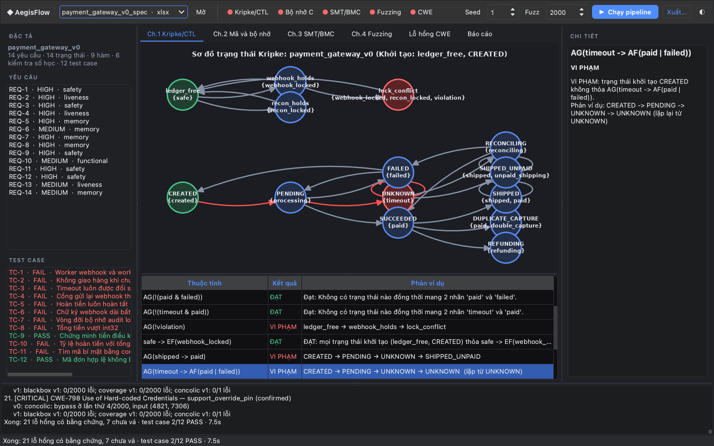
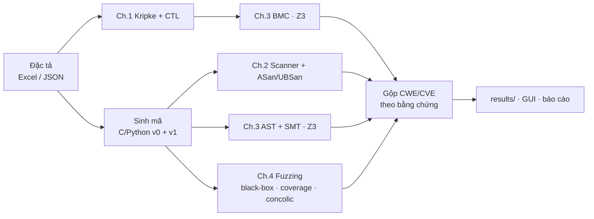
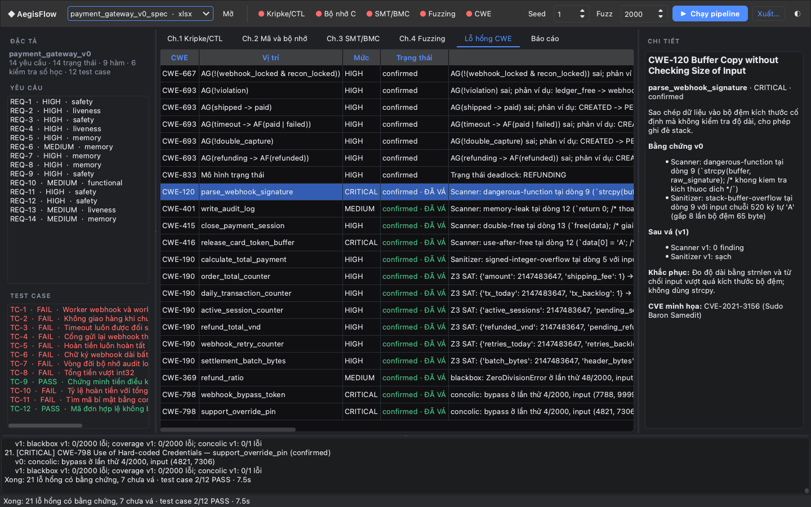

<div align="center">

# 🛡️ AegisFlow

**Kiểm chứng an toàn luồng thanh toán từ đặc tả: Kripke/CTL · Z3 BMC/SMT · Sanitizer · Fuzzing**


</div>

AegisFlow nhận **một đặc tả yêu cầu** (Excel 10 sheet theo template học phần, hoặc JSON) và chạy toàn bộ
chuỗi kiểm chứng của 4 chương môn *An toàn phần mềm*. Mỗi kết luận đều kèm **bằng chứng do công cụ sinh ra**:
phản ví dụ, log sanitizer, model của Z3, input gây lỗi của fuzzer. Kết quả là một thư mục `results/` dùng
trực tiếp cho báo cáo.

> Bài tập lớn học phần **CSE703093 — An toàn phần mềm**, Đại học Phenikaa.
> Hướng đề tài: **Chủ đề 5 — Quy trình end-to-end tích hợp cả 4 chương**.



---

## Mục lục

- [Vì sao cần AegisFlow](#vì-sao-cần-aegisflow)
- [Tính năng](#tính-năng)
- [Kiến trúc](#kiến-trúc)
- [Cài đặt](#cài-đặt)
- [Bắt đầu nhanh](#bắt-đầu-nhanh)
- [Kết quả trên đặc tả cổng thanh toán](#kết-quả-trên-đặc-tả-cổng-thanh-toán)
- [Viết đặc tả của riêng bạn](#viết-đặc-tả-của-riêng-bạn)
- [Thư mục kết quả `results/`](#thư-mục-kết-quả-results)
- [Báo cáo LaTeX và đóng gói bài nộp](#báo-cáo-latex-và-đóng-gói-bài-nộp)
- [Kiểm thử](#kiểm-thử)
- [Cấu trúc mã nguồn](#cấu-trúc-mã-nguồn)
- [Giới hạn đã biết](#giới-hạn-đã-biết)
- [Lịch sử repo](#lịch-sử-repo)

---

## Vì sao cần AegisFlow

Lỗi trong phần mềm thanh toán hiếm khi là một dòng code sai đơn lẻ. Chúng thường là:

- **Lỗi thiết kế trạng thái**: giao hàng khi cổng thanh toán timeout, ghi nhận thu tiền hai lần khi webhook bị
  gửi lại, hoàn tiền không bao giờ kết thúc. Không test case hữu hạn nào chứng minh được các lỗi này.
- **Lỗi bộ nhớ và số học** ở các hàm nhận dữ liệu từ ngoài vào: tràn bộ đệm chữ ký webhook, tổng tiền tràn
  int32 thành số âm.
- **Cửa hậu**: một cặp "mã bí mật" hardcode vượt qua xác thực. Fuzzer ngẫu nhiên gần như không bao giờ tìm ra.

Mỗi lớp lỗi cần một kỹ thuật khác nhau. AegisFlow ghép cả bốn kỹ thuật lên **cùng một đặc tả** và chỉ báo cáo
những gì công cụ thực sự tái hiện được.

## Tính năng

| Chương | Kỹ thuật | Chi tiết | Module |
|:---:|---|---|---|
| **1** | Model checking CTL | Parser đệ quy đầy đủ (`AG AF AX EG EF EX`, `E[p U q]`, `A[p U q]`, `! & \| -> <->`, lồng tùy ý); thuật toán gán nhãn fixpoint; phản ví dụ ngắn nhất, **lasso** cho `AF`; cảnh báo nhãn gõ sai; công thức lỗi cú pháp bị báo **LỖI**, không bao giờ được coi là "đạt" | `core/ctl.py`, `core/kripke.py` |
| **1** | Deadlock, mutual exclusion | Kiểm tra **mọi** cặp trong `LoaiTruLanNhau` (tool gốc của môn chỉ kiểm tra dòng đầu) | `core/kripke.py` |
| **3** | Bounded Model Checking | Mã hóa `I(s₀) ∧ ⋀R(sᵢ,sᵢ₊₁) ∧ ⋁bad(sᵢ)` bằng Z3, chạy tăng dần theo k, completeness threshold = đường kính khả đạt | `core/bmc.py` |
| **2** | Sinh mã v0/v1 | Mỗi hàm sinh **hai bản cùng chữ ký**: v0 chứa lỗi khai báo, v1 đã vá. Nhờ vậy cùng một harness/fuzzer chạy được trên cả hai | `core/codegen.py` |
| **2** | Phân tích tĩnh C | Theo dõi vòng đời con trỏ theo luồng: `strcpy/sprintf/gets`, format string, `malloc` không kiểm tra NULL, double free, use-after-free, leak | `core/c_analyzer.py` |
| **2** | ASan / UBSan | Sinh harness, biên dịch `-fsanitize=address,undefined`, chạy với input độc hại, đọc log thành finding (kèm dòng lỗi); dùng cppcheck nếu máy có | `core/toolchain.py` |
| **3** | AST, McCabe | Biến, điều kiện, vòng lặp, V(G), độ sâu lồng nhau cho C và Python | `core/static_ast.py` |
| **3** | SMT (Z3) | Mọi biến ràng buộc trong miền int32; lý thuyết **bit-vector** để thấy wrap-around thật; **chứng minh bản vá** bằng UNSAT | `core/arithmetic_z3.py` |
| **4** | Fuzzing | Black-box, coverage-guided (hill climbing theo line coverage), **concolic** (path condition từ AST + Z3). Cùng ngân sách, seed cố định. Mã sinh ra chạy trong sandbox kiểm tra AST | `core/fuzzing.py` |
| — | Gộp CWE theo bằng chứng | Ánh xạ CWE theo bảng của học phần; trạng thái v0/v1; lỗi khai báo mà không công cụ nào tái hiện được bị đánh dấu `declared-only` | `core/cwe_analyzer.py` |
| — | Test case tự đánh giá | Đọc câu "kết quả mong đợi" (vd `Không phát hiện CWE-120 tại parse_webhook_signature`, `AG(shipped -> paid) ĐÚNG`) rồi chấm PASS/FAIL | `core/pipeline.py` |
| — | Xuất bằng chứng | Markdown, bảng trước/sau, so sánh thiết kế v0 → v1, log thô, mã nguồn, hình PNG + TikZ | `core/reporter.py` |

## Kiến trúc



CLI và GUI dùng chung một điểm vào duy nhất là `core.pipeline.run_pipeline`. Vì vậy những gì hiển thị trên
giao diện giống hệt những gì được xuất ra `results/`.

## Cài đặt

Yêu cầu:

- Python 3.11 – 3.13 và [uv](https://docs.astral.sh/uv/)
- `clang` hoặc `gcc` để chạy AddressSanitizer / UBSan. Nếu không có, bước này được bỏ qua và ghi rõ trong kết quả.
- Tùy chọn: `cppcheck`; `tectonic` hoặc TeX Live để biên dịch báo cáo LaTeX

```bash
git clone git@github.com:nhatcoi/aegis-flow.git
cd aegis-flow
uv sync
```

## Bắt đầu nhanh

**Giao diện desktop**: chọn đặc tả, bấm **▶ Chạy pipeline**, rồi bấm vào một thuộc tính để xem phản ví dụ trên đồ thị.

```bash
uv run python main.py
```

**Dòng lệnh**: chạy pipeline trên đặc tả có lỗi (v0), so sánh với thiết kế đã sửa (v1), xuất vào `results/`:

```bash
uv run python -m core.pipeline dataset/specs_excel/payment_gateway_v0_spec.xlsx --compare dataset/specs_excel/payment_gateway_v1_spec.xlsx --seed 1 --budget 2000
```

| Tùy chọn | Ý nghĩa |
|---|---|
| `--seed N` | Seed của fuzzer, giúp tái tạo kết quả (mặc định 1) |
| `--budget N` | Số lần thử cho mỗi chiến lược fuzzing (mặc định 2000) |
| `--bmc-depth K` | Độ sâu tối đa của BMC (mặc định = completeness threshold của mô hình) |
| `--sanitizer-timeout S` | Thời gian tối đa (giây) cho mỗi lần chạy harness ASan/UBSan (mặc định 30) |
| `--out DIR` | Thư mục xuất (mặc định `results/<tên đặc tả>`) |
| `--compare SPEC` | Chạy thêm đặc tả đã sửa và ghi `comparison.md` |
| `--no-tools` | Bỏ qua biên dịch, ASan, cppcheck |

**Giải thích bằng AI (tùy chọn)**: trong panel Chi tiết, nút *✨ Giải thích bằng AI* gửi nội dung đang xem
(phản ví dụ, chẩn đoán, log thô) tới một API tương thích OpenAI để diễn giải bằng lời. Cấu hình trong file `.env`
(đã nằm trong `.gitignore`): `OPENAI_API_KEY`, `OPENAI_BASE_URL`, `OPENAI_MODEL` (hoặc `AEGIS_AI_*`). Phần diễn giải
được gắn nhãn *không phải bằng chứng*, không ảnh hưởng tới kết luận PASS/FAIL, CWE hay thư mục `results/`.

## Kết quả trên đặc tả cổng thanh toán

Đặc tả chính mô tả một cổng thanh toán thương mại điện tử: vòng đời đơn hàng (tạo, chờ cổng, timeout, đối soát,
thu tiền, giao hàng, hoàn tiền), khóa sổ cái giữa worker webhook và worker đối soát, 9 hàm C/Python và 6 bộ đếm
số học. `v0` là thiết kế ban đầu còn lỗi, `v1` là thiết kế đã sửa.

| | v0 (có lỗi) | v1 (đã sửa) |
|---|---|---|
| Thuộc tính CTL + mutex + deadlock | **7/14 vi phạm**, mỗi cái có phản ví dụ | 14/14 đạt |
| BMC (Z3) | 4 thuộc tính UNSAFE, phản ví dụ độ dài 2–3 | tất cả SAFE, đạt completeness threshold (CT = 4) |
| Lỗ hổng có bằng chứng | **21** (0 lỗi chỉ khai báo) | 0 chưa vá |
| Test case truy vết | 2/12 PASS | **12/12 PASS** |

Một số bằng chứng tiêu biểu (xem đầy đủ trong `results/payment_gateway_v0/`):

- **Giao hàng khi chưa thu tiền**: `AG(shipped -> paid)` sai, phản ví dụ `CREATED → PENDING → UNKNOWN → SHIPPED_UNPAID`.
- **Chờ vô hạn khi timeout**: `AG(timeout -> AF(paid | failed))` sai, phản ví dụ lasso `… → UNKNOWN → UNKNOWN (lặp)`.
- **CWE-120**: ASan `stack-buffer-overflow` tại `parse_webhook_signature_v0.c:9` (ghi 521 byte vào bộ đệm 65 byte). Bản v1 từ chối input quá dài và chạy sạch.
- **CWE-190**: Z3 tìm ra `1 073 758 211 + 1 074 004 237 = −2 147 204 848` (tổng tiền âm). Với tiền điều kiện của bản vá, truy vấn trả **UNSAT**.
- **CWE-798**: black-box và coverage-guided fuzzing đều 0/2000; **concolic tìm ra `(7788, 9999)` ở lần chạy thứ 4**.



## Viết đặc tả của riêng bạn

Đặc tả Excel gồm 10 sheet: `ThongTin`, `YeuCauChucNang`, `YeuCauPhiChucNang`, `RangBuoc`, `MoHinhTrangThai`,
`ThuocTinhAnToan`, `LoaiTruLanNhau`, `HamSinhMa`, `KiemTraSoHoc`, `TestCase`. Định dạng này tương thích với template
của học phần, kèm một số mở rộng. Chi tiết:

- [`dataset/specs_excel/FORMAT_EXCEL.md`](dataset/specs_excel/FORMAT_EXCEL.md): định dạng Excel, cú pháp CTL, giá trị cột `Loi`, các mẫu câu kết quả mong đợi được chấm tự động
- [`dataset/specs/FORMAT.md`](dataset/specs/FORMAT.md): định dạng JSON tương đương
- [`scripts/build_payment_specs.py`](scripts/build_payment_specs.py): ví dụ sinh cặp đặc tả v0/v1 bằng code

**Bản nháp bằng AI (tùy chọn)**: nút *✨ Đặc tả AI…* trên thanh công cụ nhận mô tả hệ thống bằng lời và nhờ
model tạo đặc tả JSON. Bản nháp được kiểm tra bằng chính bộ nạp đặc tả (trạng thái chưa khai báo, CTL sai cú pháp,
nhãn không tồn tại, kind không có khuôn sinh mã, ngõ cụt) và xem trước sơ đồ Kripke trước khi lưu vào
`dataset/drafts/` (kèm trường `_draft` ghi rõ do AI tạo). Bản nháp chỉ để thử nghiệm; đặc tả dùng cho báo cáo phải
do nhóm viết.

Các điểm khác so với tool gốc của môn học:

| Mục | Hành vi |
|---|---|
| `ThuocTinhAnToan` | CTL đầy đủ, lồng nhau; công thức kiểm tra tại **mọi** trạng thái khởi tạo |
| `LoaiTruLanNhau` | Kiểm tra **mọi** dòng |
| `HamSinhMa.Loi` | C: `buffer-overflow`, `memory-leak`, `double-free`, `use-after-free`, `integer-overflow` (arithmetic). Python: để trống = có lỗi (giống tool gốc), `safe` = đã vá |
| `TestCase.KetQuaMongDoi` | Được chấm PASS/FAIL tự động nếu nêu tiêu chí kiểm tra được |

## Thư mục kết quả `results/`

```text
results/payment_gateway_v0/
├── report.md          kết quả theo chương, phân tích từng CWE theo 5 mục
├── before_after.md    bảng tổng hợp trước/sau
├── comparison.md      so sánh thiết kế v0 → v1 (khi dùng --compare)
├── summary.json       toàn bộ số liệu dạng máy đọc được
├── environment.txt    OS, Python, Z3, clang, seed, ngân sách
├── logs/              ctl.txt · bmc.txt · scan.txt/json · sanitizer_*.log · z3.txt
│                      ast.csv · fuzz.csv · fuzz_events.txt · tests.csv
├── source/            mã sinh ra *_v0 và *_v1
├── figures/           kripke.png · kripke.tex (TikZ, tô đỏ phản ví dụ)
└── build/             harness và mã C đã biên dịch với sanitizer
```

## Báo cáo LaTeX và đóng gói bài nộp

Thư mục [`report/`](report/) chứa báo cáo BTL. Khung báo cáo theo hướng dẫn của học phần: 7 phần, mỗi CWE phân tích
theo 5 mục, có bảng trước/sau. Số liệu lấy từ `results/`. Biên dịch bằng XeLaTeX (hoặc dùng Overleaf):

```bash
cd report && tectonic -X compile main.tex
```

Đóng gói theo cấu trúc nộp bài `MSSV_HoTen_BTL/`, gồm báo cáo PDF, `source/`, `results/` và README chạy lại:

```bash
uv run python scripts/package_submission.py --mssv 2201xxxx --name "Họ Tên" --pdf report/main.pdf
```

## Kiểm thử

```bash
uv run pytest
uv run ruff check core gui tests scripts main.py
```

Bộ test gồm 156 test. Một số nhóm chính:

- **CTL**: kiểm tra từng toán tử; đối chiếu 30 mô hình ngẫu nhiên với bộ duyệt đường đi vét cạn; hồi quy cho lỗi `AG(!(a & b))` của phiên bản cũ.
- **BMC**: phản ví dụ tối thiểu, đạt hoặc chưa đạt completeness threshold.
- **Scanner và sanitizer**: mỗi luật có ví dụ dương tính và âm tính; ASan bắt được v0 và sạch trên v1 (tự bỏ qua khi máy không có trình biên dịch).
- **SMT**: model nằm trong miền int32, wrap-around bit-vector, bản vá cho UNSAT.
- **Fuzzing**: concolic tìm ra magic value trong khi black-box không tìm ra; kết quả tái tạo được theo seed.
- **End-to-end**: v0 có đủ các CWE mong đợi, v1 sạch và 12/12 test case PASS; CLI ghi đủ các file trong `results/`.
- `tests/web/`: test cho bản web cũ.

## Cấu trúc mã nguồn

```text
core/        pipeline phân tích (ctl, kripke, bmc, codegen, c_analyzer, toolchain,
             static_ast, arithmetic_z3, fuzzing, cwe_analyzer, pipeline, reporter)
gui/         giao diện PyQt6 (qt_app.py, theme.py)
dataset/     đặc tả payment_gateway v0/v1 (Excel: specs_excel/, JSON: specs/), flash_sale_inventory, tài liệu định dạng
scripts/     build_payment_specs.py, package_submission.py
results/     bằng chứng đã xuất cho payment_gateway_v0 / v1
report/      báo cáo LaTeX (main.tex, sections/, figures/)
docs/        hình minh họa cho README
tests/       pytest cho pipeline; tests/web/ cho bản web
backend/, frontend/, specs/   bản web (FastAPI + React) trước đây, không thuộc pipeline chính
```

## Giới hạn đã biết

- **Mô hình và cài đặt thật có khoảng cách.** CTL/BMC chứng minh tính chất của *mô hình trạng thái* trong đặc tả,
  không phải của một hệ thống thanh toán viết tay.
- **Mã được sinh từ đặc tả** nên nhỏ, và lỗi được cài có chủ đích. Công cụ bắt được các lỗi này không có nghĩa là
  sẽ bắt được lỗi tinh vi hơn trong mã thật.
- **Static scanner** dựa trên mẫu, chỉ trong phạm vi một hàm, không phân tích alias, nên không sound cũng không
  complete. Finding của nó được đối chiếu với ASan.
- **LeakSanitizer không hỗ trợ macOS**, nên CWE-401 trên macOS chỉ có bằng chứng tĩnh. Chạy trên Linux để có log leak.
- **Sanitizer** chỉ chạy một input độc hại cho mỗi hàm; tính an toàn của bản vá số học được chứng minh bằng Z3.
- **Concolic** chỉ mô hình hóa tập con cú pháp Python của mã sinh ra. Hàm gọi thư viện ngoài (`os.environ`, `hmac`)
  được ghi nhận là "không mô hình hóa được".

## Lịch sử repo

Nhánh `main` là AegisFlow bản Python hiện tại. Mã nguồn cũ của repo (dự án Java: Spring Boot starter với các module
`aegis-flow-core/bmc/smt/fuzz`) được giữ nguyên ở nhánh [`aegisflow`](https://github.com/nhatcoi/aegis-flow/tree/aegisflow).
