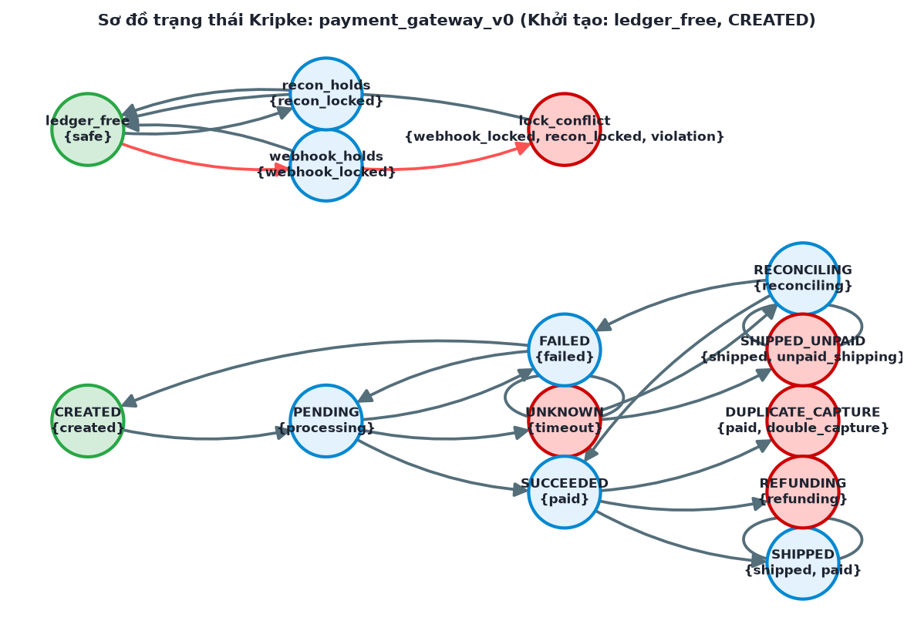

# Kết quả kiểm chứng: `payment_gateway_v0`

Cổng thanh toán cho đơn hàng thương mại điện tử: vòng đời thanh toán (tạo đơn, chờ cổng, timeout, đối soát, thu tiền, giao hàng, hoàn tiền); khóa sổ cái dùng chung giữa worker xử lý webhook và worker đối soát; các hàm phân tích chữ ký webhook/mã đơn, ghi audit log, đóng phiên, giải phóng token thẻ; bộ đếm tổng tiền và giao dịch cần kiểm tra tràn số. Phiên bản v0: thiết kế ban đầu còn lỗi.

## Môi trường chạy

| Mục | Giá trị |
|---|---|
| thời gian | 2026-09-29 23:30:14 +0700 |
| hệ điều hành | Darwin 25.2.0 (arm64) |
| python | 3.11.15 |
| z3-solver | 4.16.0 |
| trình biên dịch C | Apple clang version 17.0.0 (clang-1700.6.3.2) |
| seed | 1 |
| ngân sách fuzzing | 2000 |

## 1. Đặc tả

| ID | Danh mục | Ưu tiên | Nội dung |
|---|---|---|---|
| REQ-1 | safety | HIGH | Chỉ được giao hàng (shipped) khi đơn đã được xác nhận thu tiền (paid) |
| REQ-2 | liveness | HIGH | Khi cổng thanh toán timeout, đơn cuối cùng phải được đối soát xong (paid hoặc failed), không chờ vô hạn |
| REQ-3 | safety | HIGH | Worker webhook và worker đối soát không được đồng thời giữ khóa sổ cái (mutual exclusion) |
| REQ-4 | liveness | HIGH | Hệ thống không rơi vào deadlock khi tranh chấp khóa sổ cái hoặc khi hoàn tiền |
| REQ-5 | memory | HIGH | Hàm parse_webhook_signature không được gây tràn bộ đệm khi nhận chữ ký từ webhook |
| REQ-6 | memory | MEDIUM | Hàm write_audit_log phải giải phóng bộ nhớ đã cấp phát cho mỗi bản ghi audit |
| REQ-7 | memory | HIGH | Hàm close_payment_session không được giải phóng cùng một con trỏ nhiều hơn một lần |
| REQ-8 | memory | HIGH | Hàm release_card_token_buffer không được truy cập bộ đệm token sau khi đã giải phóng |
| REQ-9 | safety | HIGH | Hàm calculate_total_payment không được để tổng tiền hàng + phí vận chuyển tràn int32 |
| REQ-10 | functional | MEDIUM | Hàm refund_ratio không được lỗi khi tổng tiền đơn hàng bằng 0 |
| REQ-11 | safety | HIGH | Không tồn tại mã bí mật hardcode cho phép vượt qua xác thực webhook hoặc PIN hỗ trợ |
| REQ-12 | safety | HIGH | Một đơn hàng không được ghi nhận thu tiền hai lần khi cổng gửi lại webhook (idempotency) |
| REQ-13 | liveness | MEDIUM | Mọi yêu cầu hoàn tiền cuối cùng phải hoàn tất (refunded) |
| REQ-14 | memory | MEDIUM | Hàm parse_order_id chỉ chấp nhận mã đơn không vượt quá độ dài quy định |

## 2. Chương 1 — Kripke và CTL

- |S| = 14, |R| = 23, S0 = ledger_free, CREATED
- Trạng thái không đạt tới: không
- Deadlock: REFUNDING

| Thuộc tính | Kết quả | Phản ví dụ / ghi chú |
|---|---|---|
| Kiểm tra Deadlock (Bế tắc) | VI PHẠM | VI PHẠM: Phát hiện 1 trạng thái bế tắc (không có chuyển tiếp thoát ra): REFUNDING |
| AG(!(webhook_locked & recon_locked)) | VI PHẠM | ledger_free → webhook_holds → lock_conflict |
| AG(!(violation & safe)) | ĐẠT | Đạt: Không có trạng thái nào đồng thời mang 2 nhãn 'violation' và 'safe'. |
| AG(!(processing & paid)) | ĐẠT | Đạt: Không có trạng thái nào đồng thời mang 2 nhãn 'processing' và 'paid'. |
| AG(!(paid & failed)) | ĐẠT | Đạt: Không có trạng thái nào đồng thời mang 2 nhãn 'paid' và 'failed'. |
| AG(!(timeout & paid)) | ĐẠT | Đạt: Không có trạng thái nào đồng thời mang 2 nhãn 'timeout' và 'paid'. |
| AG(!violation) | VI PHẠM | ledger_free → webhook_holds → lock_conflict |
| safe -> EF(webhook_locked) | ĐẠT | ĐẠT: mọi trạng thái khởi tạo (ledger_free, CREATED) thỏa safe -> EF(webhook_locked). |
| AG(shipped -> paid) | VI PHẠM | CREATED → PENDING → UNKNOWN → SHIPPED_UNPAID |
| AG(timeout -> AF(paid \| failed)) | VI PHẠM | CREATED → PENDING → UNKNOWN → UNKNOWN (lặp từ UNKNOWN) |
| AG(!double_capture) | VI PHẠM | CREATED → PENDING → SUCCEEDED → DUPLICATE_CAPTURE |
| AG(!(processing & paid)) | ĐẠT | ĐẠT: mọi trạng thái khởi tạo (ledger_free, CREATED) thỏa AG(!(processing & paid)). |
| created -> EF(shipped) | ĐẠT | ĐẠT: mọi trạng thái khởi tạo (ledger_free, CREATED) thỏa created -> EF(shipped). |
| AG(refunding -> AF(refunded)) | VI PHẠM | CREATED → PENDING → SUCCEEDED → REFUNDING → REFUNDING (lặp từ REFUNDING) |

**Cảnh báo:**

- Nhãn 'refunded' không xuất hiện ở bất kỳ trạng thái nào (sai chính tả?) — được coi là luôn sai.



### Bounded Model Checking (Z3)

| Thuộc tính | Kết luận | k vi phạm | CT | Phản ví dụ |
|---|---|---|---|---|
| AG(!violation) | UNSAFE | 2 | 3 | ledger_free → webhook_holds → lock_conflict |
| AG(shipped -> paid) | UNSAFE | 3 | 3 | CREATED → PENDING → UNKNOWN → SHIPPED_UNPAID |
| AG(!double_capture) | UNSAFE | 3 | 3 | CREATED → PENDING → SUCCEEDED → DUPLICATE_CAPTURE |
| AG(!(processing & paid)) | SAFE (đạt CT) | — | 3 | — |
| AG(!(webhook_locked & recon_locked)) | UNSAFE | 2 | 3 | ledger_free → webhook_holds → lock_conflict |
| AG(!(violation & safe)) | SAFE (đạt CT) | — | 3 | — |
| AG(!(paid & failed)) | SAFE (đạt CT) | — | 3 | — |
| AG(!(timeout & paid)) | SAFE (đạt CT) | — | 3 | — |

## 3. Chương 2 — Phân tích bộ nhớ trên mã C sinh ra

**Static scanner:**

| Hàm | Bản | Finding |
|---|---|---|
| parse_webhook_signature | v0 | dangerous-function (dòng 9) |
| parse_webhook_signature | v1 | 0 finding |
| parse_order_id | v0 | 0 finding |
| parse_order_id | v1 | 0 finding |
| write_audit_log | v0 | memory-leak (dòng 12) |
| write_audit_log | v1 | 0 finding |
| close_payment_session | v0 | double-free (dòng 13) |
| close_payment_session | v1 | 0 finding |
| release_card_token_buffer | v0 | use-after-free (dòng 12) |
| release_card_token_buffer | v1 | 0 finding |
| calculate_total_payment | v0 | 0 finding |
| calculate_total_payment | v1 | 0 finding |

**AddressSanitizer / UBSan:**

| Hàm | Bản | Input | Kết quả | Phát hiện |
|---|---|---|---|---|
| parse_webhook_signature | v0 | chuỗi 520 ký tự 'A' (gấp 8 lần bộ đệm 65 byte) | detected | stack-buffer-overflow (CWE-121) dòng 9 |
| parse_webhook_signature | v1 | chuỗi 520 ký tự 'A' (gấp 8 lần bộ đệm 65 byte) | clean | — |
| write_audit_log | v0 | gọi hàm một lần | clean | — |
| write_audit_log | v1 | gọi hàm một lần | clean | — |
| close_payment_session | v0 | gọi hàm một lần | detected | double-free (CWE-415) dòng 13 |
| close_payment_session | v1 | gọi hàm một lần | clean | — |
| release_card_token_buffer | v0 | gọi hàm một lần | detected | heap-use-after-free (CWE-416) dòng 12 |
| release_card_token_buffer | v1 | gọi hàm một lần | clean | — |
| calculate_total_payment | v0 | (INT_MAX, 1) | detected | signed-integer-overflow (CWE-190) dòng 5 |
| calculate_total_payment | v1 | (INT_MAX, 1) | clean | — |

> LeakSanitizer không hỗ trợ trên macOS: CWE-401 chỉ có bằng chứng tĩnh.

## 4. Chương 3 — AST và SMT

| Hàm | Bản | Biến | Điều kiện | McCabe V(G) | Độ sâu lồng |
|---|---|---|---|---|---|
| parse_webhook_signature | v0 | raw_signature, buffer | — | 1 | 1 |
| parse_webhook_signature | v1 | raw_signature, buffer, len | raw_signature == NULL; len >= sizeof buffer | 3 | 1 |
| parse_order_id | v0 | raw_order_id, buffer, len | raw_order_id == NULL; len >= sizeof buffer | 3 | 1 |
| parse_order_id | v1 | raw_order_id, buffer, len | raw_order_id == NULL; len >= sizeof buffer | 3 | 1 |
| write_audit_log | v0 | data | data == NULL | 2 | 1 |
| write_audit_log | v1 | data | data == NULL | 2 | 1 |
| close_payment_session | v0 | data | data == NULL | 2 | 1 |
| close_payment_session | v1 | data | data == NULL | 2 | 1 |
| release_card_token_buffer | v0 | data | data == NULL | 2 | 1 |
| release_card_token_buffer | v1 | data | data == NULL | 2 | 1 |
| calculate_total_payment | v0 | amount, shipping_fee, out | — | 1 | 1 |
| calculate_total_payment | v1 | amount, shipping_fee, out | (shipping_fee > 0 && amount > INT_MAX - shipping_fee) \|\| (shipping_fee < 0 && amount < INT_MIN - shipping_fee) | 5 | 2 |
| refund_ratio | v0 | refund_amount, total_amount | — | 1 | 0 |
| refund_ratio | v1 | refund_amount, total_amount | total_amount == 0 | 2 | 1 |
| webhook_bypass_token | v0 | header_token, secret_token | header_token == 7788; secret_token == 9999 | 3 | 2 |
| webhook_bypass_token | v1 | header_token, secret_token, expected | not expected | 2 | 1 |
| support_override_pin | v0 | pin_a, pin_b | pin_a == 4821; pin_b == 7306 | 3 | 2 |
| support_override_pin | v1 | pin_a, pin_b, expected | not expected | 2 | 1 |

**order_total_counter**

```text
=== KIỂM TRA SMT / SỐ HỌC (Z3): order_total_counter ===
- Miền biến: mọi biến amount, shipping_fee ∈ [-2147483648, 2147483647] (int32)
- Điều kiện nghiệp vụ: `amount >= 0 and shipping_fee >= 0 and amount + shipping_fee > 2000000000`
  -> SAT, ví dụ: {'amount': 2000000001, 'shipping_fee': 0}
- Biểu thức: `amount + shipping_fee`
  -> SAT [CWE-190]: có thể TRÀN int32 (thỏa cả điều kiện nghiệp vụ). Model: {'amount': 2147483647, 'shipping_fee': 1}, giá trị đúng = 2147483648
  -> Bit-vector 32-bit (C thật): {'amount': 1073758211, 'shipping_fee': 1074004237} cho kết quả wrap-around = -2147204848
- Sau vá (v1 từ chối khi `(shipping_fee > 0 and amount > INT_MAX - shipping_fee) or (shipping_fee < 0 and amount < INT_MIN - shipping_fee)`): UNSAT — bản vá loại bỏ hoàn toàn tràn số
```

**daily_transaction_counter**

```text
=== KIỂM TRA SMT / SỐ HỌC (Z3): daily_transaction_counter ===
- Miền biến: mọi biến tx_today, tx_backlog ∈ [-2147483648, 2147483647] (int32)
- Điều kiện nghiệp vụ: `tx_today >= 0 and tx_backlog >= 0 and tx_today + tx_backlog > 32767`
  -> SAT, ví dụ: {'tx_today': 32768, 'tx_backlog': 0}
- Biểu thức: `tx_today + tx_backlog`
  -> SAT [CWE-190]: có thể TRÀN int32 (thỏa cả điều kiện nghiệp vụ). Model: {'tx_today': 2147483647, 'tx_backlog': 1}, giá trị đúng = 2147483648
  -> Bit-vector 32-bit (C thật): {'tx_today': 1073758669, 'tx_backlog': 1091568162} cho kết quả wrap-around = -2129640465
- Sau vá (v1 từ chối khi `(tx_backlog > 0 and tx_today > INT_MAX - tx_backlog) or (tx_backlog < 0 and tx_today < INT_MIN - tx_backlog)`): UNSAT — bản vá loại bỏ hoàn toàn tràn số
```

**active_session_counter**

```text
=== KIỂM TRA SMT / SỐ HỌC (Z3): active_session_counter ===
- Miền biến: mọi biến active_sessions, pending_sessions ∈ [-2147483648, 2147483647] (int32)
- Điều kiện nghiệp vụ: `active_sessions >= 0 and pending_sessions >= 0 and active_sessions + pending_sessions > 65535`
  -> SAT, ví dụ: {'active_sessions': 65536, 'pending_sessions': 0}
- Biểu thức: `active_sessions + pending_sessions`
  -> SAT [CWE-190]: có thể TRÀN int32 (thỏa cả điều kiện nghiệp vụ). Model: {'active_sessions': 2147483647, 'pending_sessions': 1}, giá trị đúng = 2147483648
  -> Bit-vector 32-bit (C thật): {'active_sessions': 126353425, 'pending_sessions': 2022770840} cho kết quả wrap-around = -2145843031
- Sau vá (v1 từ chối khi `(pending_sessions > 0 and active_sessions > INT_MAX - pending_sessions) or (pending_sessions < 0 and active_sessions < INT_MIN - pending_sessions)`): UNSAT — bản vá loại bỏ hoàn toàn tràn số
```

**refund_total_vnd**

```text
=== KIỂM TRA SMT / SỐ HỌC (Z3): refund_total_vnd ===
- Miền biến: mọi biến refunded_vnd, pending_refund_vnd ∈ [-2147483648, 2147483647] (int32)
- Điều kiện nghiệp vụ: `refunded_vnd >= 0 and pending_refund_vnd >= 0 and refunded_vnd + pending_refund_vnd > 2000000000`
  -> SAT, ví dụ: {'refunded_vnd': 2000000001, 'pending_refund_vnd': 0}
- Biểu thức: `refunded_vnd + pending_refund_vnd`
  -> SAT [CWE-190]: có thể TRÀN int32 (thỏa cả điều kiện nghiệp vụ). Model: {'refunded_vnd': 2147483647, 'pending_refund_vnd': 1}, giá trị đúng = 2147483648
  -> Bit-vector 32-bit (C thật): {'refunded_vnd': 1245708304, 'pending_refund_vnd': 905973761} cho kết quả wrap-around = -2143285231
- Sau vá (v1 từ chối khi `(pending_refund_vnd > 0 and refunded_vnd > INT_MAX - pending_refund_vnd) or (pending_refund_vnd < 0 and refunded_vnd < INT_MIN - pending_refund_vnd)`): UNSAT — bản vá loại bỏ hoàn toàn tràn số
```

**webhook_retry_counter**

```text
=== KIỂM TRA SMT / SỐ HỌC (Z3): webhook_retry_counter ===
- Miền biến: mọi biến retries_today, retries_backlog ∈ [-2147483648, 2147483647] (int32)
- Điều kiện nghiệp vụ: `retries_today >= 0 and retries_backlog >= 0 and retries_today + retries_backlog > 32767`
  -> SAT, ví dụ: {'retries_today': 32768, 'retries_backlog': 0}
- Biểu thức: `retries_today + retries_backlog`
  -> SAT [CWE-190]: có thể TRÀN int32 (thỏa cả điều kiện nghiệp vụ). Model: {'retries_today': 2147483647, 'retries_backlog': 1}, giá trị đúng = 2147483648
  -> Bit-vector 32-bit (C thật): {'retries_today': 538968385, 'retries_backlog': 1644433431} cho kết quả wrap-around = -2111565480
- Sau vá (v1 từ chối khi `(retries_backlog > 0 and retries_today > INT_MAX - retries_backlog) or (retries_backlog < 0 and retries_today < INT_MIN - retries_backlog)`): UNSAT — bản vá loại bỏ hoàn toàn tràn số
```

**settlement_batch_bytes**

```text
=== KIỂM TRA SMT / SỐ HỌC (Z3): settlement_batch_bytes ===
- Miền biến: mọi biến batch_bytes, header_bytes ∈ [-2147483648, 2147483647] (int32)
- Điều kiện nghiệp vụ: `batch_bytes >= 0 and header_bytes >= 0 and batch_bytes + header_bytes > 2000000000`
  -> SAT, ví dụ: {'batch_bytes': 2000000001, 'header_bytes': 0}
- Biểu thức: `batch_bytes + header_bytes`
  -> SAT [CWE-190]: có thể TRÀN int32 (thỏa cả điều kiện nghiệp vụ). Model: {'batch_bytes': 2147483647, 'header_bytes': 1}, giá trị đúng = 2147483648
  -> Bit-vector 32-bit (C thật): {'batch_bytes': 126353408, 'header_bytes': 2022842372} cho kết quả wrap-around = -2145771516
- Sau vá (v1 từ chối khi `(header_bytes > 0 and batch_bytes > INT_MAX - header_bytes) or (header_bytes < 0 and batch_bytes < INT_MIN - header_bytes)`): UNSAT — bản vá loại bỏ hoàn toàn tràn số
```

## 5. Chương 4 — Fuzzing

| Hàm | Bản | Chiến lược | Lần thử | Số lỗi | Lần đầu tìm thấy | Input | Loại | Thời gian |
|---|---|---|---|---|---|---|---|---|
| refund_ratio | v0 | blackbox | 2000 | 47 | 48 | (2147483646, 0) | ZeroDivisionError | 29.6 ms |
| refund_ratio | v0 | coverage | 2000 | 24 | 6 | (1, 0) | ZeroDivisionError | 3.9 ms |
| refund_ratio | v0 | concolic | 3 | 1 | 2 | (-2147483648, 0) | ZeroDivisionError | 4.4 ms |
| refund_ratio | v1 | blackbox | 2000 | 0 | — | — | — | 1.9 ms |
| refund_ratio | v1 | coverage | 2000 | 0 | — | — | — | 3.8 ms |
| refund_ratio | v1 | concolic | 3 | 0 | — | — | — | 4.0 ms |
| webhook_bypass_token | v0 | blackbox | 2000 | 0 | — | — | — | 1.8 ms |
| webhook_bypass_token | v0 | coverage | 2000 | 0 | — | — | — | 3.9 ms |
| webhook_bypass_token | v0 | concolic | 5 | 1 | 4 | (7788, 9999) | bypass | 14.9 ms |
| webhook_bypass_token | v1 | blackbox | 2000 | 0 | — | — | — | 2.6 ms |
| webhook_bypass_token | v1 | coverage | 2000 | 0 | — | — | — | 5.9 ms |
| webhook_bypass_token | v1 | concolic | 1 | 0 | — | — | — | 0.1 ms |
| support_override_pin | v0 | blackbox | 2000 | 0 | — | — | — | 1.7 ms |
| support_override_pin | v0 | coverage | 2000 | 0 | — | — | — | 4.1 ms |
| support_override_pin | v0 | concolic | 5 | 1 | 4 | (4821, 7306) | bypass | 9.1 ms |
| support_override_pin | v1 | blackbox | 2000 | 0 | — | — | — | 2.5 ms |
| support_override_pin | v1 | coverage | 2000 | 0 | — | — | — | 6.0 ms |
| support_override_pin | v1 | concolic | 1 | 0 | — | — | — | 0.1 ms |

## 6. Phân tích từng lỗ hổng

### 6.1. CWE-667 (Improper Locking) tại `AG(!(webhook_locked & recon_locked))` — confirmed

1. **Vị trí:** AG(!(webhook_locked & recon_locked)) lock_conflict
2. **Nguyên nhân:** Hai mệnh đề loại trừ lẫn nhau cùng đúng tại một trạng thái đạt được (liên quan CWE-362 race condition).
3. **Bằng chứng lỗi tồn tại:**
   - AG(!(webhook_locked & recon_locked)) sai; phản ví dụ: ledger_free -> webhook_holds -> lock_conflict
   - BMC SAT tại k=2: ledger_free -> webhook_holds -> lock_conflict
4. **Cách vá:** Đồng bộ hóa bằng mutex/khóa nguyên tử; loại bỏ chuyển tiếp dẫn tới trạng thái xung đột.
5. **Bằng chứng đã vá:** —
   - Ví dụ CVE: CVE-2016-5195 (Dirty COW)

### 6.2. CWE-693 (Protection Mechanism Failure) tại `AG(!violation)` — confirmed

1. **Vị trí:** AG(!violation) lock_conflict
2. **Nguyên nhân:** Một thuộc tính an toàn/sống còn (CTL) của đặc tả bị vi phạm.
3. **Bằng chứng lỗi tồn tại:**
   - AG(!violation) sai; phản ví dụ: ledger_free -> webhook_holds -> lock_conflict
   - BMC SAT tại k=2: ledger_free -> webhook_holds -> lock_conflict
4. **Cách vá:** Sửa mô hình trạng thái theo phản ví dụ; bổ sung điều kiện chặn (guard) còn thiếu.
5. **Bằng chứng đã vá:** —
   - Ví dụ CVE: -

### 6.3. CWE-693 (Protection Mechanism Failure) tại `AG(shipped -> paid)` — confirmed

1. **Vị trí:** AG(shipped -> paid) SHIPPED_UNPAID
2. **Nguyên nhân:** Một thuộc tính an toàn/sống còn (CTL) của đặc tả bị vi phạm.
3. **Bằng chứng lỗi tồn tại:**
   - AG(shipped -> paid) sai; phản ví dụ: CREATED -> PENDING -> UNKNOWN -> SHIPPED_UNPAID
   - BMC SAT tại k=3: CREATED -> PENDING -> UNKNOWN -> SHIPPED_UNPAID
4. **Cách vá:** Sửa mô hình trạng thái theo phản ví dụ; bổ sung điều kiện chặn (guard) còn thiếu.
5. **Bằng chứng đã vá:** —
   - Ví dụ CVE: -

### 6.4. CWE-693 (Protection Mechanism Failure) tại `AG(timeout -> AF(paid | failed))` — confirmed

1. **Vị trí:** AG(timeout -> AF(paid | failed)) UNKNOWN
2. **Nguyên nhân:** Một thuộc tính an toàn/sống còn (CTL) của đặc tả bị vi phạm.
3. **Bằng chứng lỗi tồn tại:**
   - AG(timeout -> AF(paid | failed)) sai; phản ví dụ: CREATED -> PENDING -> UNKNOWN -> UNKNOWN
4. **Cách vá:** Sửa mô hình trạng thái theo phản ví dụ; bổ sung điều kiện chặn (guard) còn thiếu.
5. **Bằng chứng đã vá:** —
   - Ví dụ CVE: -

### 6.5. CWE-693 (Protection Mechanism Failure) tại `AG(!double_capture)` — confirmed

1. **Vị trí:** AG(!double_capture) DUPLICATE_CAPTURE
2. **Nguyên nhân:** Một thuộc tính an toàn/sống còn (CTL) của đặc tả bị vi phạm.
3. **Bằng chứng lỗi tồn tại:**
   - AG(!double_capture) sai; phản ví dụ: CREATED -> PENDING -> SUCCEEDED -> DUPLICATE_CAPTURE
   - BMC SAT tại k=3: CREATED -> PENDING -> SUCCEEDED -> DUPLICATE_CAPTURE
4. **Cách vá:** Sửa mô hình trạng thái theo phản ví dụ; bổ sung điều kiện chặn (guard) còn thiếu.
5. **Bằng chứng đã vá:** —
   - Ví dụ CVE: -

### 6.6. CWE-693 (Protection Mechanism Failure) tại `AG(refunding -> AF(refunded))` — confirmed

1. **Vị trí:** AG(refunding -> AF(refunded)) REFUNDING
2. **Nguyên nhân:** Một thuộc tính an toàn/sống còn (CTL) của đặc tả bị vi phạm.
3. **Bằng chứng lỗi tồn tại:**
   - AG(refunding -> AF(refunded)) sai; phản ví dụ: CREATED -> PENDING -> SUCCEEDED -> REFUNDING -> REFUNDING
4. **Cách vá:** Sửa mô hình trạng thái theo phản ví dụ; bổ sung điều kiện chặn (guard) còn thiếu.
5. **Bằng chứng đã vá:** —
   - Ví dụ CVE: -

### 6.7. CWE-833 (Deadlock) tại `Mô hình trạng thái` — confirmed

1. **Vị trí:** Mô hình trạng thái REFUNDING
2. **Nguyên nhân:** Trạng thái đạt được không có chuyển tiếp đi ra: hệ thống treo.
3. **Bằng chứng lỗi tồn tại:**
   - Trạng thái deadlock: REFUNDING
4. **Cách vá:** Bổ sung chuyển tiếp thoát (timeout/đối soát) hoặc self-loop nếu là trạng thái kết thúc hợp lệ.
5. **Bằng chứng đã vá:** —
   - Ví dụ CVE: CVE-2020-25692 (OpenLDAP)

### 6.8. CWE-120 (Buffer Copy without Checking Size of Input) tại `parse_webhook_signature` — confirmed

1. **Vị trí:** parse_webhook_signature dòng 9; truy vết REQ-5
2. **Nguyên nhân:** Sao chép dữ liệu vào bộ đệm kích thước cố định mà không kiểm tra độ dài, cho phép ghi đè stack.
3. **Bằng chứng lỗi tồn tại:**
   - Scanner: dangerous-function tại dòng 9 (`strcpy(buffer, raw_signature); /* khong kiem tra kich thuoc dich */`)
   - Sanitizer: stack-buffer-overflow tại dòng 9 với input chuỗi 520 ký tự 'A' (gấp 8 lần bộ đệm 65 byte)
4. **Cách vá:** Đo độ dài bằng strnlen và từ chối input vượt quá kích thước bộ đệm; không dùng strcpy.

```c
/* v0 */
#define _POSIX_C_SOURCE 200809L
#include <stdio.h>
#include <stdlib.h>
#include <string.h>

/* parse_webhook_signature: sao chep du lieu dau vao vao bo dem 65 byte (v0 - co loi) */
int parse_webhook_signature(const char *raw_signature) {
    char buffer[65];
    strcpy(buffer, raw_signature); /* khong kiem tra kich thuoc dich */
    printf("%s\n", buffer);
    return 0;
}
```
```c
/* v1 */
#define _POSIX_C_SOURCE 200809L
#include <stdio.h>
#include <stdlib.h>
#include <string.h>

/* parse_webhook_signature: sao chep du lieu dau vao vao bo dem 65 byte (v1 - da va) */
int parse_webhook_signature(const char *raw_signature) {
    char buffer[65];
    if (raw_signature == NULL) return -1;
    size_t len = strnlen(raw_signature, sizeof buffer);
    if (len >= sizeof buffer) return -1; /* tu choi input qua dai thay vi cat bot */
    memcpy(buffer, raw_signature, len);
    buffer[len] = '\0';
    printf("%s\n", buffer);
    return 0;
}
```
5. **Bằng chứng đã vá:** Scanner v1: 0 finding; Sanitizer v1: sạch
   - Ví dụ CVE: CVE-2021-3156 (Sudo Baron Samedit)

### 6.9. CWE-401 (Missing Release of Memory after Effective Lifetime) tại `write_audit_log` — confirmed

1. **Vị trí:** write_audit_log dòng 12; truy vết REQ-6
2. **Nguyên nhân:** Vùng nhớ cấp phát không được giải phóng trên mọi đường thoát, gây cạn kiệt bộ nhớ (DoS dài hạn).
3. **Bằng chứng lỗi tồn tại:**
   - Scanner: memory-leak tại dòng 12 (`return 0; /* thoat ma khong free */`)
4. **Cách vá:** Đảm bảo mọi nhánh thoát (kể cả nhánh lỗi) đều gọi free().

```c
/* v0 */
#define _POSIX_C_SOURCE 200809L
#include <stdio.h>
#include <stdlib.h>
#include <string.h>

/* write_audit_log: cap phat, su dung va giai phong vung nho 64 byte (v0 - co loi) */
int write_audit_log(void) {
    char *data = (char *)malloc(64);
    if (data == NULL) return -1;
    memset(data, 0, 64);
    data[0] = 'A';
    return 0; /* thoat ma khong free */
}
```
```c
/* v1 */
#define _POSIX_C_SOURCE 200809L
#include <stdio.h>
#include <stdlib.h>
#include <string.h>

/* write_audit_log: cap phat, su dung va giai phong vung nho 64 byte (v1 - da va) */
int write_audit_log(void) {
    char *data = (char *)malloc(64);
    if (data == NULL) return -1;
    memset(data, 0, 64);
    data[0] = 'A';
    free(data);
    data = NULL; /* tranh double-free / use-after-free */
    return 0;
}
```
5. **Bằng chứng đã vá:** Scanner v1: 0 finding; Sanitizer v1: sạch
   - Ví dụ CVE: CVE-2019-11478 (Linux SACK)

### 6.10. CWE-415 (Double Free) tại `close_payment_session` — confirmed

1. **Vị trí:** close_payment_session dòng 13; truy vết REQ-7
2. **Nguyên nhân:** Giải phóng cùng một vùng nhớ heap hai lần, làm hỏng metadata của bộ cấp phát.
3. **Bằng chứng lỗi tồn tại:**
   - Scanner: double-free tại dòng 13 (`free(data); /* giai phong lan thu hai */`)
   - Sanitizer: double-free tại dòng 13 với input gọi hàm một lần
4. **Cách vá:** Gán con trỏ về NULL ngay sau free(); quy định rõ chủ sở hữu (ownership) của vùng nhớ.

```c
/* v0 */
#define _POSIX_C_SOURCE 200809L
#include <stdio.h>
#include <stdlib.h>
#include <string.h>

/* close_payment_session: cap phat, su dung va giai phong vung nho 16 byte (v0 - co loi) */
int close_payment_session(void) {
    char *data = (char *)malloc(16);
    if (data == NULL) return -1;
    memset(data, 0, 16);
    data[0] = 'A';
    free(data);
    free(data); /* giai phong lan thu hai */
    return 0;
}
```
```c
/* v1 */
#define _POSIX_C_SOURCE 200809L
#include <stdio.h>
#include <stdlib.h>
#include <string.h>

/* close_payment_session: cap phat, su dung va giai phong vung nho 16 byte (v1 - da va) */
int close_payment_session(void) {
    char *data = (char *)malloc(16);
    if (data == NULL) return -1;
    memset(data, 0, 16);
    data[0] = 'A';
    free(data);
    data = NULL; /* tranh double-free / use-after-free */
    return 0;
}
```
5. **Bằng chứng đã vá:** Scanner v1: 0 finding; Sanitizer v1: sạch
   - Ví dụ CVE: CVE-2019-11932 (WhatsApp)

### 6.11. CWE-416 (Use After Free) tại `release_card_token_buffer` — confirmed

1. **Vị trí:** release_card_token_buffer dòng 12; truy vết REQ-8
2. **Nguyên nhân:** Truy cập vùng nhớ sau khi đã giải phóng, có thể dẫn tới thực thi mã tùy ý.
3. **Bằng chứng lỗi tồn tại:**
   - Scanner: use-after-free tại dòng 12 (`data[0] = 'A'; /* ghi sau khi da free */`)
   - Sanitizer: heap-use-after-free tại dòng 12 với input gọi hàm một lần
4. **Cách vá:** Không dùng con trỏ sau free(); gán NULL ngay sau khi giải phóng.

```c
/* v0 */
#define _POSIX_C_SOURCE 200809L
#include <stdio.h>
#include <stdlib.h>
#include <string.h>

/* release_card_token_buffer: cap phat, su dung va giai phong vung nho 33 byte (v0 - co loi) */
int release_card_token_buffer(void) {
    char *data = (char *)malloc(33);
    if (data == NULL) return -1;
    memset(data, 0, 33);
    free(data);
    data[0] = 'A'; /* ghi sau khi da free */
    return 0;
}
```
```c
/* v1 */
#define _POSIX_C_SOURCE 200809L
#include <stdio.h>
#include <stdlib.h>
#include <string.h>

/* release_card_token_buffer: cap phat, su dung va giai phong vung nho 33 byte (v1 - da va) */
int release_card_token_buffer(void) {
    char *data = (char *)malloc(33);
    if (data == NULL) return -1;
    memset(data, 0, 33);
    data[0] = 'A';
    free(data);
    data = NULL; /* tranh double-free / use-after-free */
    return 0;
}
```
5. **Bằng chứng đã vá:** Scanner v1: 0 finding; Sanitizer v1: sạch
   - Ví dụ CVE: CVE-2019-0708 (BlueKeep)

### 6.12. CWE-190 (Integer Overflow or Wraparound) tại `calculate_total_payment` — confirmed

1. **Vị trí:** calculate_total_payment dòng 5; truy vết REQ-9
2. **Nguyên nhân:** Phép tính số nguyên vượt miền int32 và bị wrap-around (ví dụ tổng tiền thành số âm).
3. **Bằng chứng lỗi tồn tại:**
   - Sanitizer: signed-integer-overflow tại dòng 5 với input (INT_MAX, 1)
4. **Cách vá:** Kiểm tra a > INT_MAX - b trước khi cộng, hoặc dùng kiểu rộng hơn.

```c
/* v0 */
#include <limits.h>

/* calculate_total_payment: cong hai so nguyen 32-bit (v0 - co loi) */
int calculate_total_payment(int amount, int shipping_fee, int *out) {
    *out = amount + shipping_fee; /* co the tran so: undefined behavior */
    return 0;
}
```
```c
/* v1 */
#include <limits.h>

/* calculate_total_payment: cong hai so nguyen 32-bit (v1 - da va) */
int calculate_total_payment(int amount, int shipping_fee, int *out) {
    if ((shipping_fee > 0 && amount > INT_MAX - shipping_fee) || (shipping_fee < 0 && amount < INT_MIN - shipping_fee)) {
        return -1; /* tu choi thay vi de tran so */
    }
    *out = amount + shipping_fee;
    return 0;
}
```
5. **Bằng chứng đã vá:** Scanner v1: 0 finding; Sanitizer v1: sạch
   - Ví dụ CVE: CVE-2018-10299 (BeautyChain BEC token)

### 6.13. CWE-190 (Integer Overflow or Wraparound) tại `order_total_counter` — confirmed

1. **Vị trí:** order_total_counter
2. **Nguyên nhân:** Phép tính số nguyên vượt miền int32 và bị wrap-around (ví dụ tổng tiền thành số âm).
3. **Bằng chứng lỗi tồn tại:**
   - Z3 SAT: {'amount': 2147483647, 'shipping_fee': 1} → giá trị đúng 2147483648; bit-vector 32-bit wrap-around = -2147204848
4. **Cách vá:** Kiểm tra a > INT_MAX - b trước khi cộng, hoặc dùng kiểu rộng hơn.
5. **Bằng chứng đã vá:** Z3 UNSAT với tiền điều kiện của v1
   - Ví dụ CVE: CVE-2018-10299 (BeautyChain BEC token)

### 6.14. CWE-190 (Integer Overflow or Wraparound) tại `daily_transaction_counter` — confirmed

1. **Vị trí:** daily_transaction_counter
2. **Nguyên nhân:** Phép tính số nguyên vượt miền int32 và bị wrap-around (ví dụ tổng tiền thành số âm).
3. **Bằng chứng lỗi tồn tại:**
   - Z3 SAT: {'tx_today': 2147483647, 'tx_backlog': 1} → giá trị đúng 2147483648; bit-vector 32-bit wrap-around = -2129640465
4. **Cách vá:** Kiểm tra a > INT_MAX - b trước khi cộng, hoặc dùng kiểu rộng hơn.
5. **Bằng chứng đã vá:** Z3 UNSAT với tiền điều kiện của v1
   - Ví dụ CVE: CVE-2018-10299 (BeautyChain BEC token)

### 6.15. CWE-190 (Integer Overflow or Wraparound) tại `active_session_counter` — confirmed

1. **Vị trí:** active_session_counter
2. **Nguyên nhân:** Phép tính số nguyên vượt miền int32 và bị wrap-around (ví dụ tổng tiền thành số âm).
3. **Bằng chứng lỗi tồn tại:**
   - Z3 SAT: {'active_sessions': 2147483647, 'pending_sessions': 1} → giá trị đúng 2147483648; bit-vector 32-bit wrap-around = -2145843031
4. **Cách vá:** Kiểm tra a > INT_MAX - b trước khi cộng, hoặc dùng kiểu rộng hơn.
5. **Bằng chứng đã vá:** Z3 UNSAT với tiền điều kiện của v1
   - Ví dụ CVE: CVE-2018-10299 (BeautyChain BEC token)

### 6.16. CWE-190 (Integer Overflow or Wraparound) tại `refund_total_vnd` — confirmed

1. **Vị trí:** refund_total_vnd
2. **Nguyên nhân:** Phép tính số nguyên vượt miền int32 và bị wrap-around (ví dụ tổng tiền thành số âm).
3. **Bằng chứng lỗi tồn tại:**
   - Z3 SAT: {'refunded_vnd': 2147483647, 'pending_refund_vnd': 1} → giá trị đúng 2147483648; bit-vector 32-bit wrap-around = -2143285231
4. **Cách vá:** Kiểm tra a > INT_MAX - b trước khi cộng, hoặc dùng kiểu rộng hơn.
5. **Bằng chứng đã vá:** Z3 UNSAT với tiền điều kiện của v1
   - Ví dụ CVE: CVE-2018-10299 (BeautyChain BEC token)

### 6.17. CWE-190 (Integer Overflow or Wraparound) tại `webhook_retry_counter` — confirmed

1. **Vị trí:** webhook_retry_counter
2. **Nguyên nhân:** Phép tính số nguyên vượt miền int32 và bị wrap-around (ví dụ tổng tiền thành số âm).
3. **Bằng chứng lỗi tồn tại:**
   - Z3 SAT: {'retries_today': 2147483647, 'retries_backlog': 1} → giá trị đúng 2147483648; bit-vector 32-bit wrap-around = -2111565480
4. **Cách vá:** Kiểm tra a > INT_MAX - b trước khi cộng, hoặc dùng kiểu rộng hơn.
5. **Bằng chứng đã vá:** Z3 UNSAT với tiền điều kiện của v1
   - Ví dụ CVE: CVE-2018-10299 (BeautyChain BEC token)

### 6.18. CWE-190 (Integer Overflow or Wraparound) tại `settlement_batch_bytes` — confirmed

1. **Vị trí:** settlement_batch_bytes
2. **Nguyên nhân:** Phép tính số nguyên vượt miền int32 và bị wrap-around (ví dụ tổng tiền thành số âm).
3. **Bằng chứng lỗi tồn tại:**
   - Z3 SAT: {'batch_bytes': 2147483647, 'header_bytes': 1} → giá trị đúng 2147483648; bit-vector 32-bit wrap-around = -2145771516
4. **Cách vá:** Kiểm tra a > INT_MAX - b trước khi cộng, hoặc dùng kiểu rộng hơn.
5. **Bằng chứng đã vá:** Z3 UNSAT với tiền điều kiện của v1
   - Ví dụ CVE: CVE-2018-10299 (BeautyChain BEC token)

### 6.19. CWE-369 (Divide By Zero) tại `refund_ratio` — confirmed

1. **Vị trí:** refund_ratio; truy vết REQ-10
2. **Nguyên nhân:** Phép chia không kiểm tra mẫu số bằng 0, gây crash (DoS).
3. **Bằng chứng lỗi tồn tại:**
   - blackbox: ZeroDivisionError ở lần thử 48/2000, input (2147483646, 0)
   - coverage: ZeroDivisionError ở lần thử 6/2000, input (1, 0)
   - concolic: ZeroDivisionError ở lần thử 2/2000, input (-2147483648, 0)
4. **Cách vá:** Kiểm tra mẫu số khác 0 trước khi chia.

```python
# v0
def refund_ratio(refund_amount, total_amount):
    return refund_amount // total_amount
```
```python
# v1
def refund_ratio(refund_amount, total_amount):
    if total_amount == 0:
        return 0
    return refund_amount // total_amount
```
5. **Bằng chứng đã vá:** blackbox v1: 0/2000 lỗi; coverage v1: 0/2000 lỗi; concolic v1: 0/3 lỗi
   - Ví dụ CVE: CVE-2020-1971

### 6.20. CWE-798 (Use of Hard-coded Credentials) tại `webhook_bypass_token` — confirmed

1. **Vị trí:** webhook_bypass_token
2. **Nguyên nhân:** Giá trị bí mật hardcode trong mã nguồn cho phép vượt qua xác thực.
3. **Bằng chứng lỗi tồn tại:**
   - concolic: bypass ở lần thử 4/2000, input (7788, 9999)
4. **Cách vá:** Bỏ nhánh bí mật; so khớp với bí mật cấu hình ngoài mã nguồn bằng hmac.compare_digest.

```python
# v0
def webhook_bypass_token(header_token, secret_token):
    if header_token == 7788:
        if secret_token == 9999:
            return True
    return False
```
```python
# v1
import hmac
import os


def webhook_bypass_token(header_token, secret_token):
    expected = os.environ.get("WEBHOOK_SECRET", "")
    if not expected:
        return False
    return hmac.compare_digest(f"{header_token}:{secret_token}", expected)
```
5. **Bằng chứng đã vá:** blackbox v1: 0/2000 lỗi; coverage v1: 0/2000 lỗi; concolic v1: 0/1 lỗi
   - Ví dụ CVE: CVE-2020-10148 (SolarWinds Orion auth bypass)

### 6.21. CWE-798 (Use of Hard-coded Credentials) tại `support_override_pin` — confirmed

1. **Vị trí:** support_override_pin
2. **Nguyên nhân:** Giá trị bí mật hardcode trong mã nguồn cho phép vượt qua xác thực.
3. **Bằng chứng lỗi tồn tại:**
   - concolic: bypass ở lần thử 4/2000, input (4821, 7306)
4. **Cách vá:** Bỏ nhánh bí mật; so khớp với bí mật cấu hình ngoài mã nguồn bằng hmac.compare_digest.

```python
# v0
def support_override_pin(pin_a, pin_b):
    if pin_a == 4821:
        if pin_b == 7306:
            return True
    return False
```
```python
# v1
import hmac
import os


def support_override_pin(pin_a, pin_b):
    expected = os.environ.get("WEBHOOK_SECRET", "")
    if not expected:
        return False
    return hmac.compare_digest(f"{pin_a}:{pin_b}", expected)
```
5. **Bằng chứng đã vá:** blackbox v1: 0/2000 lỗi; coverage v1: 0/2000 lỗi; concolic v1: 0/1 lỗi
   - Ví dụ CVE: CVE-2020-10148 (SolarWinds Orion auth bypass)

## 7. Bảng tổng hợp trước/sau

| CWE | Vị trí | Trạng thái v0 | Trạng thái v1 | Công cụ xác minh |
|---|---|---|---|---|
| CWE-667 | AG(!(webhook_locked & recon_locked)) | AG(!(webhook_locked & recon_locked)) sai; phản ví dụ: ledger_free -> webhook_holds -> lock_conflict | — | Kripke, BMC (Z3) |
| CWE-693 | AG(!violation) | AG(!violation) sai; phản ví dụ: ledger_free -> webhook_holds -> lock_conflict | — | CTL, BMC (Z3) |
| CWE-693 | AG(shipped -> paid) | AG(shipped -> paid) sai; phản ví dụ: CREATED -> PENDING -> UNKNOWN -> SHIPPED_UNPAID | — | CTL, BMC (Z3) |
| CWE-693 | AG(timeout -> AF(paid \| failed)) | AG(timeout -> AF(paid \| failed)) sai; phản ví dụ: CREATED -> PENDING -> UNKNOWN -> UNKNOWN | — | CTL |
| CWE-693 | AG(!double_capture) | AG(!double_capture) sai; phản ví dụ: CREATED -> PENDING -> SUCCEEDED -> DUPLICATE_CAPTURE | — | CTL, BMC (Z3) |
| CWE-693 | AG(refunding -> AF(refunded)) | AG(refunding -> AF(refunded)) sai; phản ví dụ: CREATED -> PENDING -> SUCCEEDED -> REFUNDING -> REFUNDING | — | CTL |
| CWE-833 | Mô hình trạng thái | Trạng thái deadlock: REFUNDING | — | Kripke |
| CWE-120 | parse_webhook_signature | Scanner: dangerous-function tại dòng 9 (`strcpy(buffer, raw_signature); /* khong kiem tra kich thuoc dich */`) | Scanner v1: 0 finding; Sanitizer v1: sạch | Static scanner, ASan/UBSan |
| CWE-401 | write_audit_log | Scanner: memory-leak tại dòng 12 (`return 0; /* thoat ma khong free */`) | Scanner v1: 0 finding; Sanitizer v1: sạch | Static scanner |
| CWE-415 | close_payment_session | Scanner: double-free tại dòng 13 (`free(data); /* giai phong lan thu hai */`) | Scanner v1: 0 finding; Sanitizer v1: sạch | Static scanner, ASan/UBSan |
| CWE-416 | release_card_token_buffer | Scanner: use-after-free tại dòng 12 (`data[0] = 'A'; /* ghi sau khi da free */`) | Scanner v1: 0 finding; Sanitizer v1: sạch | Static scanner, ASan/UBSan |
| CWE-190 | calculate_total_payment | Sanitizer: signed-integer-overflow tại dòng 5 với input (INT_MAX, 1) | Scanner v1: 0 finding; Sanitizer v1: sạch | ASan/UBSan |
| CWE-190 | order_total_counter | Z3 SAT: {'amount': 2147483647, 'shipping_fee': 1} → giá trị đúng 2147483648; bit-vector 32-bit wrap-around = -2147204848 | Z3 UNSAT với tiền điều kiện của v1 | Z3 |
| CWE-190 | daily_transaction_counter | Z3 SAT: {'tx_today': 2147483647, 'tx_backlog': 1} → giá trị đúng 2147483648; bit-vector 32-bit wrap-around = -2129640465 | Z3 UNSAT với tiền điều kiện của v1 | Z3 |
| CWE-190 | active_session_counter | Z3 SAT: {'active_sessions': 2147483647, 'pending_sessions': 1} → giá trị đúng 2147483648; bit-vector 32-bit wrap-around = -2145843031 | Z3 UNSAT với tiền điều kiện của v1 | Z3 |
| CWE-190 | refund_total_vnd | Z3 SAT: {'refunded_vnd': 2147483647, 'pending_refund_vnd': 1} → giá trị đúng 2147483648; bit-vector 32-bit wrap-around = -2143285231 | Z3 UNSAT với tiền điều kiện của v1 | Z3 |
| CWE-190 | webhook_retry_counter | Z3 SAT: {'retries_today': 2147483647, 'retries_backlog': 1} → giá trị đúng 2147483648; bit-vector 32-bit wrap-around = -2111565480 | Z3 UNSAT với tiền điều kiện của v1 | Z3 |
| CWE-190 | settlement_batch_bytes | Z3 SAT: {'batch_bytes': 2147483647, 'header_bytes': 1} → giá trị đúng 2147483648; bit-vector 32-bit wrap-around = -2145771516 | Z3 UNSAT với tiền điều kiện của v1 | Z3 |
| CWE-369 | refund_ratio | blackbox: ZeroDivisionError ở lần thử 48/2000, input (2147483646, 0) | blackbox v1: 0/2000 lỗi; coverage v1: 0/2000 lỗi; concolic v1: 0/3 lỗi | Fuzzing (blackbox), Fuzzing (coverage), Fuzzing (concolic) |
| CWE-798 | webhook_bypass_token | concolic: bypass ở lần thử 4/2000, input (7788, 9999) | blackbox v1: 0/2000 lỗi; coverage v1: 0/2000 lỗi; concolic v1: 0/1 lỗi | Fuzzing (concolic) |
| CWE-798 | support_override_pin | concolic: bypass ở lần thử 4/2000, input (4821, 7306) | blackbox v1: 0/2000 lỗi; coverage v1: 0/2000 lỗi; concolic v1: 0/1 lỗi | Fuzzing (concolic) |

## 8. Truy vết test case

| ID | Yêu cầu | Tiêu đề | Kết quả mong đợi | Thực tế | Lý do |
|---|---|---|---|---|---|
| TC-1 | REQ-3, REQ-4 | Worker webhook và worker đối soát tranh chấp khóa sổ cái | AG(!violation) ĐÚNG và không có trạng thái deadlock | FAIL | AG(!violation) = sai (mong đợi đúng); deadlock: REFUNDING |
| TC-2 | REQ-1 | Không giao hàng khi chưa thu tiền | AG(shipped -> paid) ĐÚNG | FAIL | AG(shipped -> paid) = sai (mong đợi đúng) |
| TC-3 | REQ-2 | Timeout luôn được đối soát | AG(timeout -> AF(paid \| failed)) ĐÚNG | FAIL | AG(timeout -> AF(paid \| failed)) = sai (mong đợi đúng) |
| TC-4 | REQ-12, NFR-4 | Cổng gửi lại webhook thu tiền | AG(!double_capture) ĐÚNG | FAIL | AG(!double_capture) = sai (mong đợi đúng) |
| TC-5 | REQ-13 | Hoàn tiền luôn hoàn tất | AG(refunding -> AF(refunded)) ĐÚNG và không có trạng thái deadlock | FAIL | AG(refunding -> AF(refunded)) = sai (mong đợi đúng); deadlock: REFUNDING |
| TC-6 | REQ-5, CON-1 | Chữ ký webhook dài bất thường | Không phát hiện CWE-120 tại parse_webhook_signature | FAIL | CWE-120 tại parse_webhook_signature: 1 phát hiện (mong đợi 0) |
| TC-7 | REQ-6, REQ-7, REQ-8 | Vòng đời bộ nhớ audit log / phiên / token thẻ | Không phát hiện CWE-401, CWE-415, CWE-416 | FAIL | CWE-401: 1 phát hiện (mong đợi 0); CWE-415: 1 phát hiện (mong đợi 0); CWE-416: 1 phát hiện (mong đợi 0) |
| TC-8 | REQ-9, CON-4 | Tổng tiền vượt int32 | Không phát hiện CWE-190 tại calculate_total_payment | FAIL | CWE-190 tại calculate_total_payment: 1 phát hiện (mong đợi 0) |
| TC-9 | REQ-9 | Chứng minh tiền điều kiện chống tràn bằng Z3 | Z3 SAT cho order_total_counter khi chưa kiểm tra biên và UNSAT sau khi thêm tiền điều kiện | PASS | Z3 UNSAT với tiền điều kiện của v1; Z3 SAT (tồn tại input gây tràn) |
| TC-10 | REQ-10 | Tỷ lệ hoàn tiền với tổng tiền bằng 0 | Không crash (ZeroDivisionError) tại refund_ratio | FAIL | fuzzing: 3/3 chiến dịch tìm ra lỗi (mong đợi 0) |
| TC-11 | REQ-11, CON-6 | Tìm mã bí mật bằng concolic fuzzing | Không phát hiện CWE-798 | FAIL | CWE-798: 2 phát hiện (mong đợi 0) |
| TC-12 | REQ-14, CON-2 | Mã đơn hợp lệ không bị báo lỗi nhầm | Không phát hiện CWE-120 tại parse_order_id | PASS | CWE-120 tại parse_order_id: 0 phát hiện (mong đợi 0) |
