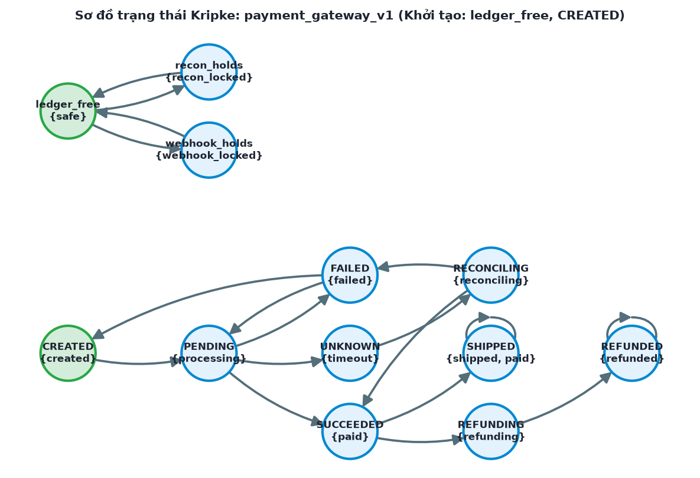

# Kết quả kiểm chứng: `payment_gateway_v1`

Cổng thanh toán cho đơn hàng thương mại điện tử: vòng đời thanh toán (tạo đơn, chờ cổng, timeout, đối soát, thu tiền, giao hàng, hoàn tiền); khóa sổ cái dùng chung giữa worker xử lý webhook và worker đối soát; các hàm phân tích chữ ký webhook/mã đơn, ghi audit log, đóng phiên, giải phóng token thẻ; bộ đếm tổng tiền và giao dịch cần kiểm tra tràn số. Phiên bản v1: thiết kế đã sửa.

## Môi trường chạy

| Mục | Giá trị |
|---|---|
| thời gian | 2026-09-29 23:30:21 +0700 |
| hệ điều hành | Darwin 25.2.0 (arm64) |
| python | 3.11.15 |
| z3-solver | 4.16.0 |
| trình biên dịch C | Apple clang version 17.0.0 (clang-1700.6.3.2) |
| seed | 1 |
| ngân sách fuzzing | 2000 |

## 1. Đặc tả

| ID | Danh mục | Ưu tiên | Nội dung |
|---|---|---|---|
| REQ-1 | safety | HIGH | Chỉ được giao hàng (shipped) khi đơn đã được xác nhận thu tiền (paid) |
| REQ-2 | liveness | HIGH | Khi cổng thanh toán timeout, đơn cuối cùng phải được đối soát xong (paid hoặc failed), không chờ vô hạn |
| REQ-3 | safety | HIGH | Worker webhook và worker đối soát không được đồng thời giữ khóa sổ cái (mutual exclusion) |
| REQ-4 | liveness | HIGH | Hệ thống không rơi vào deadlock khi tranh chấp khóa sổ cái hoặc khi hoàn tiền |
| REQ-5 | memory | HIGH | Hàm parse_webhook_signature không được gây tràn bộ đệm khi nhận chữ ký từ webhook |
| REQ-6 | memory | MEDIUM | Hàm write_audit_log phải giải phóng bộ nhớ đã cấp phát cho mỗi bản ghi audit |
| REQ-7 | memory | HIGH | Hàm close_payment_session không được giải phóng cùng một con trỏ nhiều hơn một lần |
| REQ-8 | memory | HIGH | Hàm release_card_token_buffer không được truy cập bộ đệm token sau khi đã giải phóng |
| REQ-9 | safety | HIGH | Hàm calculate_total_payment không được để tổng tiền hàng + phí vận chuyển tràn int32 |
| REQ-10 | functional | MEDIUM | Hàm refund_ratio không được lỗi khi tổng tiền đơn hàng bằng 0 |
| REQ-11 | safety | HIGH | Không tồn tại mã bí mật hardcode cho phép vượt qua xác thực webhook hoặc PIN hỗ trợ |
| REQ-12 | safety | HIGH | Một đơn hàng không được ghi nhận thu tiền hai lần khi cổng gửi lại webhook (idempotency) |
| REQ-13 | liveness | MEDIUM | Mọi yêu cầu hoàn tiền cuối cùng phải hoàn tất (refunded) |
| REQ-14 | memory | MEDIUM | Hàm parse_order_id chỉ chấp nhận mã đơn không vượt quá độ dài quy định |

## 2. Chương 1 — Kripke và CTL

- |S| = 12, |R| = 18, S0 = ledger_free, CREATED
- Trạng thái không đạt tới: không
- Deadlock: không

| Thuộc tính | Kết quả | Phản ví dụ / ghi chú |
|---|---|---|
| Kiểm tra Deadlock (Bế tắc) | ĐẠT | Đạt: Mọi trạng thái có thể tới được đều có ít nhất một chuyển tiếp đi ra (Deadlock-free). |
| AG(!(webhook_locked & recon_locked)) | ĐẠT | Đạt: Không có trạng thái nào đồng thời mang 2 nhãn 'webhook_locked' và 'recon_locked'. |
| AG(!(violation & safe)) | ĐẠT | Đạt: Không có trạng thái nào đồng thời mang 2 nhãn 'violation' và 'safe'. |
| AG(!(processing & paid)) | ĐẠT | Đạt: Không có trạng thái nào đồng thời mang 2 nhãn 'processing' và 'paid'. |
| AG(!(paid & failed)) | ĐẠT | Đạt: Không có trạng thái nào đồng thời mang 2 nhãn 'paid' và 'failed'. |
| AG(!(timeout & paid)) | ĐẠT | Đạt: Không có trạng thái nào đồng thời mang 2 nhãn 'timeout' và 'paid'. |
| AG(!violation) | ĐẠT | ĐẠT: mọi trạng thái khởi tạo (ledger_free, CREATED) thỏa AG(!violation). |
| safe -> EF(webhook_locked) | ĐẠT | ĐẠT: mọi trạng thái khởi tạo (ledger_free, CREATED) thỏa safe -> EF(webhook_locked). |
| AG(shipped -> paid) | ĐẠT | ĐẠT: mọi trạng thái khởi tạo (ledger_free, CREATED) thỏa AG(shipped -> paid). |
| AG(timeout -> AF(paid \| failed)) | ĐẠT | ĐẠT: mọi trạng thái khởi tạo (ledger_free, CREATED) thỏa AG(timeout -> AF(paid \| failed)). |
| AG(!double_capture) | ĐẠT | ĐẠT: mọi trạng thái khởi tạo (ledger_free, CREATED) thỏa AG(!double_capture). |
| AG(!(processing & paid)) | ĐẠT | ĐẠT: mọi trạng thái khởi tạo (ledger_free, CREATED) thỏa AG(!(processing & paid)). |
| created -> EF(shipped) | ĐẠT | ĐẠT: mọi trạng thái khởi tạo (ledger_free, CREATED) thỏa created -> EF(shipped). |
| AG(refunding -> AF(refunded)) | ĐẠT | ĐẠT: mọi trạng thái khởi tạo (ledger_free, CREATED) thỏa AG(refunding -> AF(refunded)). |

**Cảnh báo:**

- Nhãn 'violation' không xuất hiện ở bất kỳ trạng thái nào (sai chính tả?) — được coi là luôn sai.
- Nhãn 'double_capture' không xuất hiện ở bất kỳ trạng thái nào (sai chính tả?) — được coi là luôn sai.



### Bounded Model Checking (Z3)

| Thuộc tính | Kết luận | k vi phạm | CT | Phản ví dụ |
|---|---|---|---|---|
| AG(!violation) | SAFE (đạt CT) | — | 4 | — |
| AG(shipped -> paid) | SAFE (đạt CT) | — | 4 | — |
| AG(!double_capture) | SAFE (đạt CT) | — | 4 | — |
| AG(!(processing & paid)) | SAFE (đạt CT) | — | 4 | — |
| AG(!(webhook_locked & recon_locked)) | SAFE (đạt CT) | — | 4 | — |
| AG(!(violation & safe)) | SAFE (đạt CT) | — | 4 | — |
| AG(!(paid & failed)) | SAFE (đạt CT) | — | 4 | — |
| AG(!(timeout & paid)) | SAFE (đạt CT) | — | 4 | — |

## 3. Chương 2 — Phân tích bộ nhớ trên mã C sinh ra

**Static scanner:**

| Hàm | Bản | Finding |
|---|---|---|
| parse_webhook_signature | v0 | 0 finding |
| parse_webhook_signature | v1 | 0 finding |
| parse_order_id | v0 | 0 finding |
| parse_order_id | v1 | 0 finding |
| write_audit_log | v0 | 0 finding |
| write_audit_log | v1 | 0 finding |
| close_payment_session | v0 | 0 finding |
| close_payment_session | v1 | 0 finding |
| release_card_token_buffer | v0 | 0 finding |
| release_card_token_buffer | v1 | 0 finding |
| calculate_total_payment | v0 | 0 finding |
| calculate_total_payment | v1 | 0 finding |

**AddressSanitizer / UBSan:**

| Hàm | Bản | Input | Kết quả | Phát hiện |
|---|---|---|---|---|
| calculate_total_payment | v0 | (INT_MAX, 1) | clean | — |
| calculate_total_payment | v1 | (INT_MAX, 1) | clean | — |

> LeakSanitizer không hỗ trợ trên macOS: CWE-401 chỉ có bằng chứng tĩnh.

## 4. Chương 3 — AST và SMT

| Hàm | Bản | Biến | Điều kiện | McCabe V(G) | Độ sâu lồng |
|---|---|---|---|---|---|
| parse_webhook_signature | v0 | raw_signature, buffer, len | raw_signature == NULL; len >= sizeof buffer | 3 | 1 |
| parse_webhook_signature | v1 | raw_signature, buffer, len | raw_signature == NULL; len >= sizeof buffer | 3 | 1 |
| parse_order_id | v0 | raw_order_id, buffer, len | raw_order_id == NULL; len >= sizeof buffer | 3 | 1 |
| parse_order_id | v1 | raw_order_id, buffer, len | raw_order_id == NULL; len >= sizeof buffer | 3 | 1 |
| write_audit_log | v0 | data | data == NULL | 2 | 1 |
| write_audit_log | v1 | data | data == NULL | 2 | 1 |
| close_payment_session | v0 | data | data == NULL | 2 | 1 |
| close_payment_session | v1 | data | data == NULL | 2 | 1 |
| release_card_token_buffer | v0 | data | data == NULL | 2 | 1 |
| release_card_token_buffer | v1 | data | data == NULL | 2 | 1 |
| calculate_total_payment | v0 | amount, shipping_fee, out | (shipping_fee > 0 && amount > INT_MAX - shipping_fee) \|\| (shipping_fee < 0 && amount < INT_MIN - shipping_fee) | 5 | 2 |
| calculate_total_payment | v1 | amount, shipping_fee, out | (shipping_fee > 0 && amount > INT_MAX - shipping_fee) \|\| (shipping_fee < 0 && amount < INT_MIN - shipping_fee) | 5 | 2 |
| refund_ratio | v0 | refund_amount, total_amount | total_amount == 0 | 2 | 1 |
| refund_ratio | v1 | refund_amount, total_amount | total_amount == 0 | 2 | 1 |
| webhook_bypass_token | v0 | header_token, secret_token, expected | not expected | 2 | 1 |
| webhook_bypass_token | v1 | header_token, secret_token, expected | not expected | 2 | 1 |
| support_override_pin | v0 | pin_a, pin_b, expected | not expected | 2 | 1 |
| support_override_pin | v1 | pin_a, pin_b, expected | not expected | 2 | 1 |

**order_total_counter**

```text
=== KIỂM TRA SMT / SỐ HỌC (Z3): order_total_counter ===
- Miền biến: mọi biến amount, shipping_fee ∈ [-2147483648, 2147483647] (int32)
- Điều kiện nghiệp vụ: `amount >= 0 and shipping_fee >= 0 and amount + shipping_fee > 2000000000`
  -> SAT, ví dụ: {'amount': 2000000001, 'shipping_fee': 0}
- Biểu thức: `amount + shipping_fee`
  -> SAT [CWE-190]: có thể TRÀN int32 (thỏa cả điều kiện nghiệp vụ). Model: {'amount': 2147483647, 'shipping_fee': 1}, giá trị đúng = 2147483648
  -> Bit-vector 32-bit (C thật): {'amount': 1077938448, 'shipping_fee': 1073807372} cho kết quả wrap-around = -2143221476
- Sau vá (v1 từ chối khi `(shipping_fee > 0 and amount > INT_MAX - shipping_fee) or (shipping_fee < 0 and amount < INT_MIN - shipping_fee)`): UNSAT — bản vá loại bỏ hoàn toàn tràn số
```

**daily_transaction_counter**

```text
=== KIỂM TRA SMT / SỐ HỌC (Z3): daily_transaction_counter ===
- Miền biến: mọi biến tx_today, tx_backlog ∈ [-2147483648, 2147483647] (int32)
- Điều kiện nghiệp vụ: `tx_today >= 0 and tx_backlog >= 0 and tx_today + tx_backlog > 32767`
  -> SAT, ví dụ: {'tx_today': 32768, 'tx_backlog': 0}
- Biểu thức: `tx_today + tx_backlog`
  -> SAT [CWE-190]: có thể TRÀN int32 (thỏa cả điều kiện nghiệp vụ). Model: {'tx_today': 2147483647, 'tx_backlog': 1}, giá trị đúng = 2147483648
  -> Bit-vector 32-bit (C thật): {'tx_today': 1277168384, 'tx_backlog': 872415744} cho kết quả wrap-around = -2145383168
- Sau vá (v1 từ chối khi `(tx_backlog > 0 and tx_today > INT_MAX - tx_backlog) or (tx_backlog < 0 and tx_today < INT_MIN - tx_backlog)`): UNSAT — bản vá loại bỏ hoàn toàn tràn số
```

**active_session_counter**

```text
=== KIỂM TRA SMT / SỐ HỌC (Z3): active_session_counter ===
- Miền biến: mọi biến active_sessions, pending_sessions ∈ [-2147483648, 2147483647] (int32)
- Điều kiện nghiệp vụ: `active_sessions >= 0 and pending_sessions >= 0 and active_sessions + pending_sessions > 65535`
  -> SAT, ví dụ: {'active_sessions': 65536, 'pending_sessions': 0}
- Biểu thức: `active_sessions + pending_sessions`
  -> SAT [CWE-190]: có thể TRÀN int32 (thỏa cả điều kiện nghiệp vụ). Model: {'active_sessions': 2147483647, 'pending_sessions': 1}, giá trị đúng = 2147483648
  -> Bit-vector 32-bit (C thật): {'active_sessions': 268436064, 'pending_sessions': 1896096016} cho kết quả wrap-around = -2130435216
- Sau vá (v1 từ chối khi `(pending_sessions > 0 and active_sessions > INT_MAX - pending_sessions) or (pending_sessions < 0 and active_sessions < INT_MIN - pending_sessions)`): UNSAT — bản vá loại bỏ hoàn toàn tràn số
```

**refund_total_vnd**

```text
=== KIỂM TRA SMT / SỐ HỌC (Z3): refund_total_vnd ===
- Miền biến: mọi biến refunded_vnd, pending_refund_vnd ∈ [-2147483648, 2147483647] (int32)
- Điều kiện nghiệp vụ: `refunded_vnd >= 0 and pending_refund_vnd >= 0 and refunded_vnd + pending_refund_vnd > 2000000000`
  -> SAT, ví dụ: {'refunded_vnd': 2000000001, 'pending_refund_vnd': 0}
- Biểu thức: `refunded_vnd + pending_refund_vnd`
  -> SAT [CWE-190]: có thể TRÀN int32 (thỏa cả điều kiện nghiệp vụ). Model: {'refunded_vnd': 2147483647, 'pending_refund_vnd': 1}, giá trị đúng = 2147483648
  -> Bit-vector 32-bit (C thật): {'refunded_vnd': 1073743872, 'pending_refund_vnd': 1108377600} cho kết quả wrap-around = -2112845824
- Sau vá (v1 từ chối khi `(pending_refund_vnd > 0 and refunded_vnd > INT_MAX - pending_refund_vnd) or (pending_refund_vnd < 0 and refunded_vnd < INT_MIN - pending_refund_vnd)`): UNSAT — bản vá loại bỏ hoàn toàn tràn số
```

**webhook_retry_counter**

```text
=== KIỂM TRA SMT / SỐ HỌC (Z3): webhook_retry_counter ===
- Miền biến: mọi biến retries_today, retries_backlog ∈ [-2147483648, 2147483647] (int32)
- Điều kiện nghiệp vụ: `retries_today >= 0 and retries_backlog >= 0 and retries_today + retries_backlog > 32767`
  -> SAT, ví dụ: {'retries_today': 32768, 'retries_backlog': 0}
- Biểu thức: `retries_today + retries_backlog`
  -> SAT [CWE-190]: có thể TRÀN int32 (thỏa cả điều kiện nghiệp vụ). Model: {'retries_today': 2147483647, 'retries_backlog': 1}, giá trị đúng = 2147483648
  -> Bit-vector 32-bit (C thật): {'retries_today': 1073759264, 'retries_backlog': 1074004054} cho kết quả wrap-around = -2147203978
- Sau vá (v1 từ chối khi `(retries_backlog > 0 and retries_today > INT_MAX - retries_backlog) or (retries_backlog < 0 and retries_today < INT_MIN - retries_backlog)`): UNSAT — bản vá loại bỏ hoàn toàn tràn số
```

**settlement_batch_bytes**

```text
=== KIỂM TRA SMT / SỐ HỌC (Z3): settlement_batch_bytes ===
- Miền biến: mọi biến batch_bytes, header_bytes ∈ [-2147483648, 2147483647] (int32)
- Điều kiện nghiệp vụ: `batch_bytes >= 0 and header_bytes >= 0 and batch_bytes + header_bytes > 2000000000`
  -> SAT, ví dụ: {'batch_bytes': 2000000001, 'header_bytes': 0}
- Biểu thức: `batch_bytes + header_bytes`
  -> SAT [CWE-190]: có thể TRÀN int32 (thỏa cả điều kiện nghiệp vụ). Model: {'batch_bytes': 2147483647, 'header_bytes': 1}, giá trị đúng = 2147483648
  -> Bit-vector 32-bit (C thật): {'batch_bytes': 2013332489, 'header_bytes': 143655048} cho kết quả wrap-around = -2137979759
- Sau vá (v1 từ chối khi `(header_bytes > 0 and batch_bytes > INT_MAX - header_bytes) or (header_bytes < 0 and batch_bytes < INT_MIN - header_bytes)`): UNSAT — bản vá loại bỏ hoàn toàn tràn số
```

## 5. Chương 4 — Fuzzing

| Hàm | Bản | Chiến lược | Lần thử | Số lỗi | Lần đầu tìm thấy | Input | Loại | Thời gian |
|---|---|---|---|---|---|---|---|---|
| refund_ratio | v0 | blackbox | 2000 | 0 | — | — | — | 2.9 ms |
| refund_ratio | v0 | coverage | 2000 | 0 | — | — | — | 4.3 ms |
| refund_ratio | v0 | concolic | 3 | 0 | — | — | — | 3.9 ms |
| refund_ratio | v1 | blackbox | 2000 | 0 | — | — | — | 2.0 ms |
| refund_ratio | v1 | coverage | 2000 | 0 | — | — | — | 4.0 ms |
| refund_ratio | v1 | concolic | 3 | 0 | — | — | — | 3.9 ms |
| webhook_bypass_token | v0 | blackbox | 2000 | 0 | — | — | — | 2.5 ms |
| webhook_bypass_token | v0 | coverage | 2000 | 0 | — | — | — | 5.8 ms |
| webhook_bypass_token | v0 | concolic | 1 | 0 | — | — | — | 0.0 ms |
| webhook_bypass_token | v1 | blackbox | 2000 | 0 | — | — | — | 2.5 ms |
| webhook_bypass_token | v1 | coverage | 2000 | 0 | — | — | — | 5.7 ms |
| webhook_bypass_token | v1 | concolic | 1 | 0 | — | — | — | 0.0 ms |
| support_override_pin | v0 | blackbox | 2000 | 0 | — | — | — | 2.5 ms |
| support_override_pin | v0 | coverage | 2000 | 0 | — | — | — | 5.8 ms |
| support_override_pin | v0 | concolic | 1 | 0 | — | — | — | 0.0 ms |
| support_override_pin | v1 | blackbox | 2000 | 0 | — | — | — | 2.5 ms |
| support_override_pin | v1 | coverage | 2000 | 0 | — | — | — | 5.8 ms |
| support_override_pin | v1 | concolic | 1 | 0 | — | — | — | 0.0 ms |

## 6. Phân tích từng lỗ hổng

### 6.1. CWE-190 (Integer Overflow or Wraparound) tại `order_total_counter` — confirmed

1. **Vị trí:** order_total_counter
2. **Nguyên nhân:** Phép tính số nguyên vượt miền int32 và bị wrap-around (ví dụ tổng tiền thành số âm).
3. **Bằng chứng lỗi tồn tại:**
   - Z3 SAT: {'amount': 2147483647, 'shipping_fee': 1} → giá trị đúng 2147483648; bit-vector 32-bit wrap-around = -2143221476
4. **Cách vá:** Kiểm tra a > INT_MAX - b trước khi cộng, hoặc dùng kiểu rộng hơn.
5. **Bằng chứng đã vá:** Z3 UNSAT với tiền điều kiện của v1
   - Ví dụ CVE: CVE-2018-10299 (BeautyChain BEC token)

### 6.2. CWE-190 (Integer Overflow or Wraparound) tại `daily_transaction_counter` — confirmed

1. **Vị trí:** daily_transaction_counter
2. **Nguyên nhân:** Phép tính số nguyên vượt miền int32 và bị wrap-around (ví dụ tổng tiền thành số âm).
3. **Bằng chứng lỗi tồn tại:**
   - Z3 SAT: {'tx_today': 2147483647, 'tx_backlog': 1} → giá trị đúng 2147483648; bit-vector 32-bit wrap-around = -2145383168
4. **Cách vá:** Kiểm tra a > INT_MAX - b trước khi cộng, hoặc dùng kiểu rộng hơn.
5. **Bằng chứng đã vá:** Z3 UNSAT với tiền điều kiện của v1
   - Ví dụ CVE: CVE-2018-10299 (BeautyChain BEC token)

### 6.3. CWE-190 (Integer Overflow or Wraparound) tại `active_session_counter` — confirmed

1. **Vị trí:** active_session_counter
2. **Nguyên nhân:** Phép tính số nguyên vượt miền int32 và bị wrap-around (ví dụ tổng tiền thành số âm).
3. **Bằng chứng lỗi tồn tại:**
   - Z3 SAT: {'active_sessions': 2147483647, 'pending_sessions': 1} → giá trị đúng 2147483648; bit-vector 32-bit wrap-around = -2130435216
4. **Cách vá:** Kiểm tra a > INT_MAX - b trước khi cộng, hoặc dùng kiểu rộng hơn.
5. **Bằng chứng đã vá:** Z3 UNSAT với tiền điều kiện của v1
   - Ví dụ CVE: CVE-2018-10299 (BeautyChain BEC token)

### 6.4. CWE-190 (Integer Overflow or Wraparound) tại `refund_total_vnd` — confirmed

1. **Vị trí:** refund_total_vnd
2. **Nguyên nhân:** Phép tính số nguyên vượt miền int32 và bị wrap-around (ví dụ tổng tiền thành số âm).
3. **Bằng chứng lỗi tồn tại:**
   - Z3 SAT: {'refunded_vnd': 2147483647, 'pending_refund_vnd': 1} → giá trị đúng 2147483648; bit-vector 32-bit wrap-around = -2112845824
4. **Cách vá:** Kiểm tra a > INT_MAX - b trước khi cộng, hoặc dùng kiểu rộng hơn.
5. **Bằng chứng đã vá:** Z3 UNSAT với tiền điều kiện của v1
   - Ví dụ CVE: CVE-2018-10299 (BeautyChain BEC token)

### 6.5. CWE-190 (Integer Overflow or Wraparound) tại `webhook_retry_counter` — confirmed

1. **Vị trí:** webhook_retry_counter
2. **Nguyên nhân:** Phép tính số nguyên vượt miền int32 và bị wrap-around (ví dụ tổng tiền thành số âm).
3. **Bằng chứng lỗi tồn tại:**
   - Z3 SAT: {'retries_today': 2147483647, 'retries_backlog': 1} → giá trị đúng 2147483648; bit-vector 32-bit wrap-around = -2147203978
4. **Cách vá:** Kiểm tra a > INT_MAX - b trước khi cộng, hoặc dùng kiểu rộng hơn.
5. **Bằng chứng đã vá:** Z3 UNSAT với tiền điều kiện của v1
   - Ví dụ CVE: CVE-2018-10299 (BeautyChain BEC token)

### 6.6. CWE-190 (Integer Overflow or Wraparound) tại `settlement_batch_bytes` — confirmed

1. **Vị trí:** settlement_batch_bytes
2. **Nguyên nhân:** Phép tính số nguyên vượt miền int32 và bị wrap-around (ví dụ tổng tiền thành số âm).
3. **Bằng chứng lỗi tồn tại:**
   - Z3 SAT: {'batch_bytes': 2147483647, 'header_bytes': 1} → giá trị đúng 2147483648; bit-vector 32-bit wrap-around = -2137979759
4. **Cách vá:** Kiểm tra a > INT_MAX - b trước khi cộng, hoặc dùng kiểu rộng hơn.
5. **Bằng chứng đã vá:** Z3 UNSAT với tiền điều kiện của v1
   - Ví dụ CVE: CVE-2018-10299 (BeautyChain BEC token)

## 7. Bảng tổng hợp trước/sau

| CWE | Vị trí | Trạng thái v0 | Trạng thái v1 | Công cụ xác minh |
|---|---|---|---|---|
| CWE-190 | order_total_counter | Z3 SAT: {'amount': 2147483647, 'shipping_fee': 1} → giá trị đúng 2147483648; bit-vector 32-bit wrap-around = -2143221476 | Z3 UNSAT với tiền điều kiện của v1 | Z3 |
| CWE-190 | daily_transaction_counter | Z3 SAT: {'tx_today': 2147483647, 'tx_backlog': 1} → giá trị đúng 2147483648; bit-vector 32-bit wrap-around = -2145383168 | Z3 UNSAT với tiền điều kiện của v1 | Z3 |
| CWE-190 | active_session_counter | Z3 SAT: {'active_sessions': 2147483647, 'pending_sessions': 1} → giá trị đúng 2147483648; bit-vector 32-bit wrap-around = -2130435216 | Z3 UNSAT với tiền điều kiện của v1 | Z3 |
| CWE-190 | refund_total_vnd | Z3 SAT: {'refunded_vnd': 2147483647, 'pending_refund_vnd': 1} → giá trị đúng 2147483648; bit-vector 32-bit wrap-around = -2112845824 | Z3 UNSAT với tiền điều kiện của v1 | Z3 |
| CWE-190 | webhook_retry_counter | Z3 SAT: {'retries_today': 2147483647, 'retries_backlog': 1} → giá trị đúng 2147483648; bit-vector 32-bit wrap-around = -2147203978 | Z3 UNSAT với tiền điều kiện của v1 | Z3 |
| CWE-190 | settlement_batch_bytes | Z3 SAT: {'batch_bytes': 2147483647, 'header_bytes': 1} → giá trị đúng 2147483648; bit-vector 32-bit wrap-around = -2137979759 | Z3 UNSAT với tiền điều kiện của v1 | Z3 |

## 8. Truy vết test case

| ID | Yêu cầu | Tiêu đề | Kết quả mong đợi | Thực tế | Lý do |
|---|---|---|---|---|---|
| TC-1 | REQ-3, REQ-4 | Worker webhook và worker đối soát tranh chấp khóa sổ cái | AG(!violation) ĐÚNG và không có trạng thái deadlock | PASS | AG(!violation) = đúng (mong đợi đúng); deadlock: không |
| TC-2 | REQ-1 | Không giao hàng khi chưa thu tiền | AG(shipped -> paid) ĐÚNG | PASS | AG(shipped -> paid) = đúng (mong đợi đúng) |
| TC-3 | REQ-2 | Timeout luôn được đối soát | AG(timeout -> AF(paid \| failed)) ĐÚNG | PASS | AG(timeout -> AF(paid \| failed)) = đúng (mong đợi đúng) |
| TC-4 | REQ-12, NFR-4 | Cổng gửi lại webhook thu tiền | AG(!double_capture) ĐÚNG | PASS | AG(!double_capture) = đúng (mong đợi đúng) |
| TC-5 | REQ-13 | Hoàn tiền luôn hoàn tất | AG(refunding -> AF(refunded)) ĐÚNG và không có trạng thái deadlock | PASS | AG(refunding -> AF(refunded)) = đúng (mong đợi đúng); deadlock: không |
| TC-6 | REQ-5, CON-1 | Chữ ký webhook dài bất thường | Không phát hiện CWE-120 tại parse_webhook_signature | PASS | CWE-120 tại parse_webhook_signature: 0 phát hiện (mong đợi 0) |
| TC-7 | REQ-6, REQ-7, REQ-8 | Vòng đời bộ nhớ audit log / phiên / token thẻ | Không phát hiện CWE-401, CWE-415, CWE-416 | PASS | CWE-401: 0 phát hiện (mong đợi 0); CWE-415: 0 phát hiện (mong đợi 0); CWE-416: 0 phát hiện (mong đợi 0) |
| TC-8 | REQ-9, CON-4 | Tổng tiền vượt int32 | Không phát hiện CWE-190 tại calculate_total_payment | PASS | CWE-190 tại calculate_total_payment: 0 phát hiện (mong đợi 0) |
| TC-9 | REQ-9 | Chứng minh tiền điều kiện chống tràn bằng Z3 | Z3 SAT cho order_total_counter khi chưa kiểm tra biên và UNSAT sau khi thêm tiền điều kiện | PASS | Z3 UNSAT với tiền điều kiện của v1; Z3 SAT (tồn tại input gây tràn) |
| TC-10 | REQ-10 | Tỷ lệ hoàn tiền với tổng tiền bằng 0 | Không crash (ZeroDivisionError) tại refund_ratio | PASS | fuzzing: 0/3 chiến dịch tìm ra lỗi (mong đợi 0) |
| TC-11 | REQ-11, CON-6 | Tìm mã bí mật bằng concolic fuzzing | Không phát hiện CWE-798 | PASS | CWE-798: 0 phát hiện (mong đợi 0) |
| TC-12 | REQ-14, CON-2 | Mã đơn hợp lệ không bị báo lỗi nhầm | Không phát hiện CWE-120 tại parse_order_id | PASS | CWE-120 tại parse_order_id: 0 phát hiện (mong đợi 0) |
